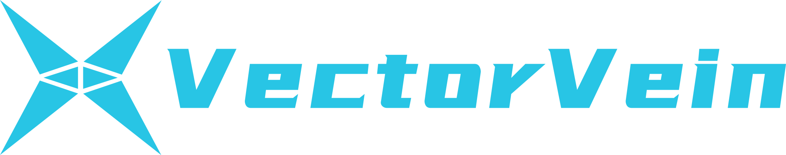
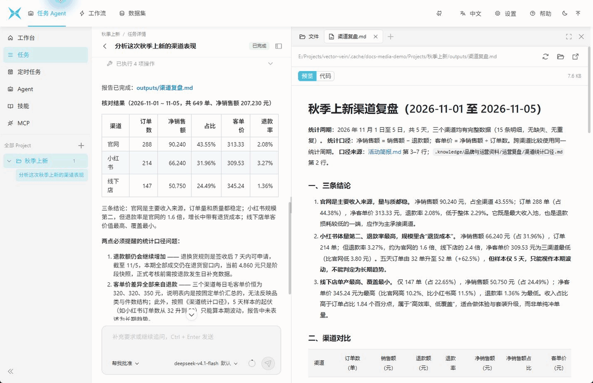
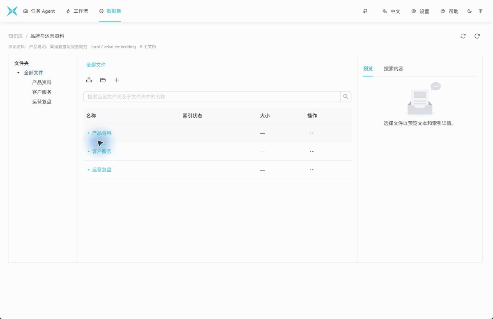
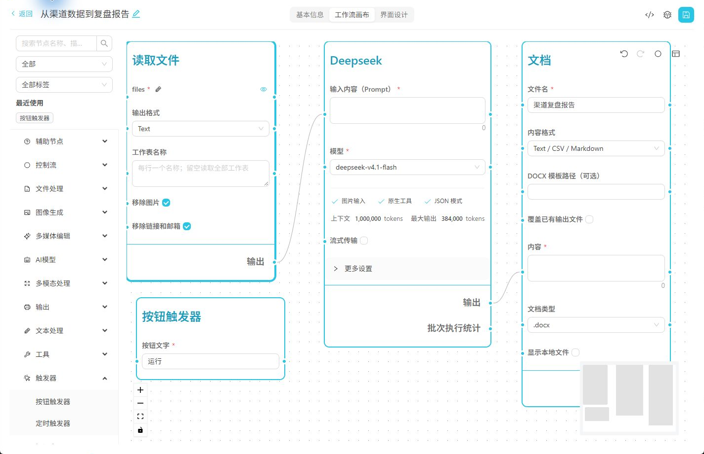

English | [简体中文](README_zh.md) | [日本語](README_ja.md)

<a href="https://vectorvein.com"></a>

# VectorVein

**A local desktop application for Task Agents and visual workflows.**

Everyday work rarely lives in a single file. You often need to read across local project folders, cross-check rules or reference documents, process spreadsheet data, and turn the findings into a clean report or workbook. VectorVein brings autonomous Task Agents and reusable visual workflows into one desktop workspace: give an Agent a goal when the job involves exploring files, searching documents, and multi-step execution; build a visual workflow when you want a fixed sequence of steps for batch processing and document export—or attach any valid workflow to an Agent as a callable tool.


[Download Desktop v1.0.2](https://github.com/AndersonBY/vector-vein/releases) · [Setup & Configuration Guide](docs/getting-started.md) · [Quickstart Tutorial](TUTORIAL.md) · [Cloud Edition](https://vectorvein.com) · [Online Docs](https://vectorvein.com/help/docs/introduction)

---

## See It in Action

In the demonstration task pictured below, a local project folder holds a launch brief and 5 days of daily channel sales and refund records, while a mounted knowledge base stores the 5-day channel reporting definitions and return policies. We ask the Agent to analyze the autumn launch across channels using the knowledge base's reporting rules, write a report to `outputs/`, and cite its sources.

From those sample files, the Agent calculates 649 total orders and ¥207,230 in net sales across the three channels, flags the 7-day return window caveat, and saves `outputs/渠道复盘.md`. Once completed, you can preview the formatted report, toggle its Markdown source, browse project files, and open the cited knowledge-base documents side by side in the workspace.



---

## Key Capabilities

### Task Workspace & Multi-Folder Projects

VectorVein opens directly to the Task Agent Workbench. You can group one or more local folders into a Project (the first folder serves as the default working directory, and any additional folders act as allowed roots) so the Agent can search, read, and write project files within clear boundaries—or start a standalone task without selecting a Project.

Inside a task, the conversation and the multi-tab workspace sit side by side. Generated reports, local code files, command output, tool results, and task plans maintained when needed by the model open in separate tabs. Even while a task is running or waiting for input, you can switch the active model, reasoning effort, or approval mode (ask every time, automatic risk review, or full access) from the bottom bar.


### Hierarchical Knowledge Bases & Hybrid Search

The Data space manages hierarchical Knowledge Bases alongside Relational Databases. Import folder trees or individual PDF, Word, Excel, PowerPoint, Markdown, and CSV files. VectorVein copies imported files into managed storage to extract text and build local indexes, leaving your original files on disk untouched—deleting an entry from a knowledge base never deletes your source file.

Each knowledge base uses a built-in local Qdrant vector index and full-text search with no external database setup required, and includes one-click presets for local [Vekai](https://github.com/AndersonBY/vekai) embedding and reranking services. When mounted to an Agent, documents are accessible both through dedicated retrieval tools and as read-only `.knowledge/` virtual paths that can be previewed directly in the task workspace.




### Extending Agents with Skills, MCP & Workflows

Save custom Agent profiles with tailored instructions, permissions, and configurable tools and capabilities:

- **Skills**: Write `SKILL.md` bundles in the built-in editor or scan and import existing skills from `~/.agents/skills`, `~/.codex/skills`, and `~/.claude/skills`.
- **MCP Servers**: Connect local or remote MCP servers, test connections to discover available tools, and enable specific tools per Agent or per task.
- **Workflows as Tools**: Attach any valid (`VALID`) visual workflow to an Agent so the Agent can invoke it with structured inputs and link the run record to the task.


### Visual Scheduling & Background Runs

Use the visual schedule editor to run recurring inspections, summaries, or workflow pipelines on daily, weekly, or custom intervals without writing Cron expressions. Agent schedules can either start a fresh task on every run or continue inside an existing task, with options to hide completed tasks from the main list and send native desktop notifications. On Windows, closing the window can minimize VectorVein to the system tray so schedules and indexing continue in the background.


### Visual Workflows & Structured Document Exports

When a process follows a fixed sequence of steps, build a node graph in the visual workflow editor. Workflows can read multi-sheet Excel files with source row numbers preserved, validate LLM outputs against a JSON Schema with optional local caching, and export formatted multi-sheet `.xlsx` workbooks, structured `.docx` documents, and `.png` charts.

Every workflow can be run from its clean daily-use screen, triggered via the local HTTP API (`http://127.0.0.1:8787` by default), or executed headlessly with `VectorVeinCLI`.



---

## Quick Start

1. **Download & Launch**: Download the `v1.0.2` archive (`vector-vein-windows-v1.0.2.zip`, `vector-vein-mac-v1.0.2.zip`, or `vector-vein-linux-v1.0.2.zip`) from [GitHub Releases](https://github.com/AndersonBY/vector-vein/releases), extract it, and run `VectorVein`. The desktop UI supports English and Simplified Chinese (note: the screenshots above show the Chinese interface).
2. **Configure a Model**: Open **Settings** in the top-right corner, add a cloud API endpoint (OpenAI, Anthropic, DeepSeek, Gemini, Qwen, etc.) or a local server (Ollama, LM Studio, vLLM), click **Test** to verify the connection, and save. (Application data is stored locally in `data/`; when you use a cloud model or external MCP service, task prompts and relevant context are sent to that configured provider.)
3. **Start a Task**: Mount any desired Knowledge Bases or Skills on your Agent profile under **Agent**, then return to the **Workbench**, choose a Project (optional), Agent, and model preset, and enter your goal. See the [Setup & Configuration Guide](docs/getting-started.md) and [Quickstart Tutorial](TUTORIAL.md) for details.

> [!IMPORTANT]
> **Upgrading from 0.x**: Exit any running 0.x instance (including the system tray process) before starting 1.0. On first launch, VectorVein automatically backs up your `data` directory to a sibling ZIP archive and verifies it before migrating your data; if the backup or verification fails, the upgrade stops immediately. After migration, legacy conversation Agent history is removed from the active database (and preserved in the backup ZIP), while Relational Databases are kept and legacy vector datasets are imported into Knowledge Bases. See the [Upgrade Guide](docs/getting-started.md#2-upgrading-from-0x-to-10).

---

## Documentation & Development

- **Setup & Walkthroughs**: [Setup, Model Configuration & Upgrade Guide](docs/getting-started.md) · [Hands-On Tutorial](TUTORIAL.md) · [Window & System Tray](docs/desktop-window.md)
- **Task Agent & Knowledge Bases**: [Task Agent Runtime](docs/task-agent-runtime.md) · [Skills & MCP](docs/task-agent-skills-mcp.md) · [Knowledge Bases & Vekai](docs/knowledge-bases.md) · [Agent Scheduling](docs/task-agent-scheduling.md) · [Model Selection](docs/model-selection.md) · [Endpoint Testing (ZH)](docs/model-endpoint-test.md)
- **Visual Workflows & CLI**: [Reliable Data Workflows](docs/reliable-workflows.md) · [Workflow CLI](docs/cli.md) · [Node Timeline (ZH)](docs/workflow-timeline.md) · [Run Artifacts (ZH)](docs/workflow-artifacts.md) · [Canvas Preview (ZH)](docs/workflow-preview.md) · [Cooperative Stopping](docs/workflow-stopping.md) · [Crash Recovery](docs/workflow-recovery.md) · [Failure Diagnostics (ZH)](docs/workflow-failures.md) · [Human Feedback](docs/workflow-feedback.md) · [Schedule Editor](docs/workflow-scheduling.md) · [HTTP Request Node (ZH)](docs/http-request-node.md) · [Web Search Settings](docs/web-search.md)
- **Releases**: [v1.0.2](docs/releases/1.0.2.md) · [v1.0.1](docs/releases/1.0.1.md) · [v1.0.0](docs/releases/1.0.0.md)

### Build from Source

Requires **Python `>=3.12, <3.13`** (with [PDM](https://pdm.fming.dev/latest/#installation)), **Node.js 22**, and **pnpm 10**.

```bash
cd frontend && pnpm install
cd ../backend && cp .env.example .env
pdm install          # On macOS: pdm install -G mac
pdm run build-front
pdm run dev
```

See the **[Development, Testing & Build Guide](docs/development.md)** for test commands, database migrations, and packaging instructions.

---

## License

VectorVein is distributed under the **VectorVein License** solely for non-commercial research purposes. See [LICENSE](LICENSE.md) for the full license terms and restrictions.