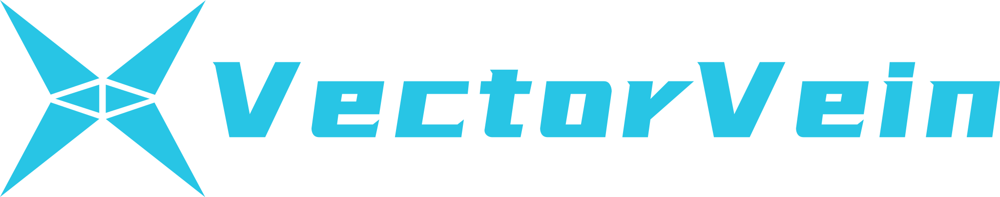
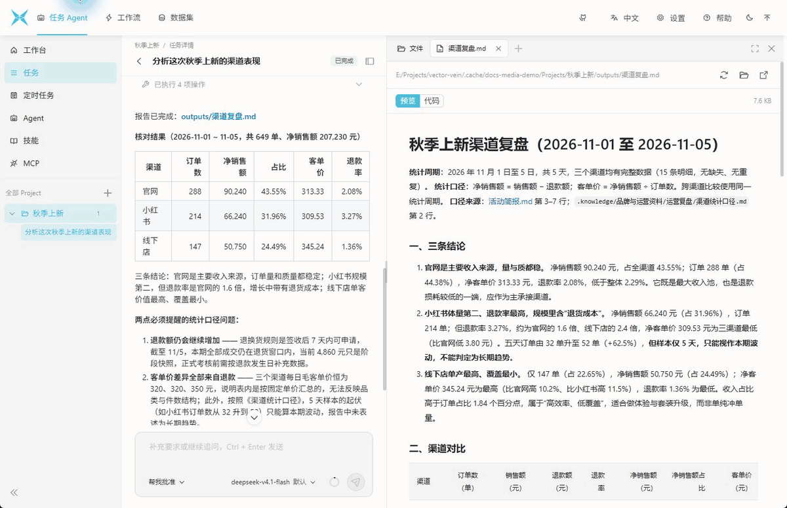
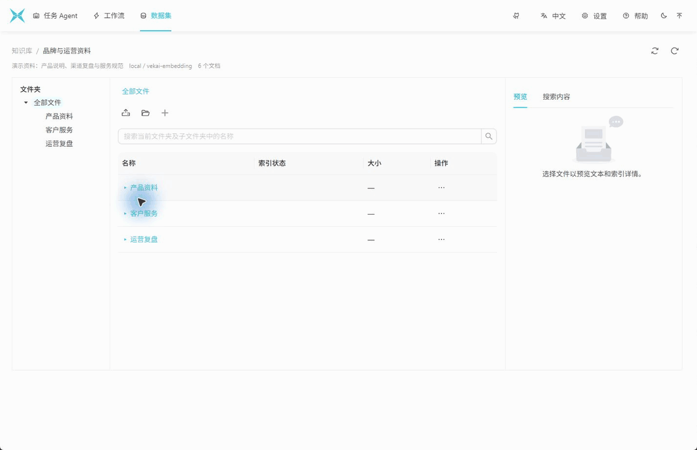
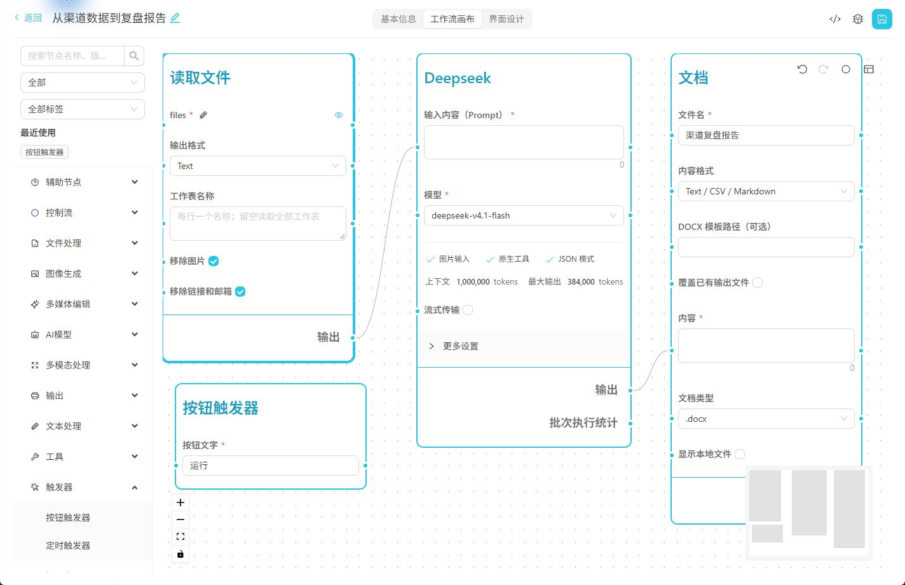

[English](README.md) | [简体中文](README_zh.md) | 日本語

<a href="https://vectorvein.com"></a>

# VectorVein（ベクトルヴェイン）

**ローカル PC 上で動く、タスク Agent とビジュアルワークフローのデスクトップツール。**

実際の業務では、複数のローカルフォルダにあるファイルを確認し、規定文書や過去の資料と照らし合わせ、データを集計してレポートや Excel 表にまとめる作業が頻繁に発生します。VectorVein は、自律的に作業を進める「タスク Agent」と、決まった手順を繰り返し実行できる「ビジュアルワークフロー」を 1 つのデスクトップアプリに統合しています。ファイル探索や多段階の調査は Agent に任せ、定型のデータ処理や帳票出力はワークフローで回し、有効なワークフローをそのまま Agent のツールとして呼び出すこともできます。


[デスクトップ版 v1.0.2 をダウンロード](https://github.com/AndersonBY/vector-vein/releases) · [セットアップ・設定ガイド (EN)](docs/getting-started.md) · [チュートリアル](TUTORIAL_ja.md) · [オンライン版](https://vectorvein.com) · [オンラインドキュメント](https://vectorvein.com/help/docs/introduction)

---

## サンプルタスクで見る動作イメージ

スクリーンショットのデモタスク「秋の新作チャネル振り返り」を例にします。ローカルの Project フォルダにはキャンペーン概要と 5 日間のチャネル別売上・返金データがあり、ナレッジベースには 5 日間のチャネル集計定義と返品ルールが登録されています。ここで Agent に「ナレッジベースの集計定義に基づき、秋の新作のチャネル別実績を比較・分析してレポートを `outputs/` に保存し、引用元を明記して」と依頼します。

Agent はサンプルデータを読み取ってナレッジベースの定義と照合し、5 日間で計 649 件の注文・純売上 207,230 元のチャネル別実績を算出して `outputs/渠道复盘.md` を生成します。タスク完了後は、右側のワークスペースでレポートのプレビューと Markdown ソースを切り替えたり、プロジェクト内のファイル一覧や引用元のナレッジ文書を開いて原文を確認したりできます。



---

## 主な機能

### タスクワークスペースと複数フォルダ Project

アプリを起動すると、タスク Agent ワークベンチが開きます。1 つ以上のローカルフォルダを **Project** として登録でき（最初のフォルダが既定の作業ディレクトリ、残りが追加の許可ディレクトリ）、許可された範囲内で Agent が横断的にファイルを検索・読み書きします。Project を指定せずに単発のタスクを実行することも可能です。

タスク詳細画面では、左側の会話ストリームと右側のマルチタブ・ワークスペースが並んで表示されます。生成されたレポート、ローカルのコード、コマンド出力、ツール実行結果、およびモデルが必要に応じて作成・更新するタスクプランを個別タブで開けます。タスクの実行中や入力待ちの間でも、下部バーからモデル・推論強度・承認モード（毎回確認／自動リスク審査／すべて許可）を切り替えられます。


### 階層型ナレッジベースとハイブリッド検索

データ空間では、階層型ナレッジベースと従来のリレーショナルデータベースを並べて管理できます。PDF、Word、Excel、PowerPoint、Markdown、CSV などのファイルやフォルダ構造をそのままインポートでき、元ファイルは管理領域へコピーしてテキスト抽出とインデックス作成を行うため、元のファイルが書き換えられたり削除されたりすることはありません。

ナレッジベースはローカル Qdrant ベクトルインデックスと全文検索を内蔵しており、外部データベースの構築は不要です。設定画面からローカルの [Vekai](https://github.com/AndersonBY/vekai) 埋め込み・リランキングサービスをワンクリックで連携することもできます。Agent にマウントすると、専用の検索ツールだけでなく、読み取り専用の `.knowledge/` 仮想パスを通じてタスクワークスペース上で直接抽出テキストをプレビュー・参照できます。




### Skills・MCP・ワークフローによる機能拡張

用途に応じた Agent プロファイルを保存し、「ツールと能力」カードでナレッジベースや 3 種類の拡張機能を組み合わせることができます：

- **Skills**：内蔵エディタで `SKILL.md` を作成するか、`~/.agents/skills`、`~/.codex/skills`、`~/.claude/skills` から既存のローカル Skill をスキャンして一括インポートできます。
- **MCP サーバー**：ローカルまたはリモートの MCP サーバーを登録し、接続テストで検出されたツールから必要なものを個別に有効化できます。
- **ワークフローのツール化**：有効な状態（`VALID`）のビジュアルワークフローを Agent にマウントし、構造化パラメータを渡して呼び出したり実行履歴を紐付けたりできます。


### スケジュール実行とバックグラウンド動作

定期的な点検や日次集計は、Cron 式を書かずにビジュアルスケジュールエディタで日時や間隔を設定できます。実行ごとに新しいタスクを作成するか、既存の同一タスクで文脈を引き継いで続行するかを選択でき、完了後の自動非表示や OS のデスクトップ通知にも対応しています。Windows 環境では、ウィンドウを閉じる際にシステムトレイへ格納してスケジューラやインデックス処理をバックグラウンドで継続できます。


### ビジュアルワークフローと構造化ドキュメント出力

手順が決まっている定型処理は、ワークフローエディタでノードをつないでパイプライン化できます。元の行番号を保持した複数シート Excel の読み込み、LLM ノードでの JSON Schema 出力検証とローカルキャッシュ、書式付きの複数シート `.xlsx`・構造化 `.docx`・`.png` チャートの直接出力に対応しています。

作成したワークフローは、専用の使用画面から実行できるほか、内蔵のローカル HTTP API（既定 `http://127.0.0.1:8787`）や同梱の `VectorVeinCLI` コマンドラインツールからも呼び出せます。



---

## クイックスタート

1. **ダウンロードと起動**：[GitHub Releases](https://github.com/AndersonBY/vector-vein/releases) からお使いの OS 向けの `v1.0.2` パッケージ（`vector-vein-windows-v1.0.2.zip`、`vector-vein-mac-v1.0.2.zip`、または `vector-vein-linux-v1.0.2.zip`）をダウンロードして展開し、`VectorVein` を実行します。（※デスクトップ UI の表示言語は現在「簡体字中国語」と「英語」に対応しており、本ページのスクリーンショットは中国語 UI での実行例です。）
2. **モデルの設定**：右上の **設定（Settings）** を開き、クラウド API（OpenAI、Anthropic、DeepSeek、Gemini、Qwen など）またはローカル推論サーバー（Ollama、LM Studio、vLLM）を設定し、**テスト** で疎通確認して保存します。（アプリのデータはローカルの `data/` に保存されます。クラウドモデルや外部 MCP サービスを選択して実行した場合は、該当するリクエスト内容が選択先のサービスへ送信されます。）
3. **タスクの開始**：ナレッジベースや Skill を使う場合は左側の **Agent** 画面で対象 Agent プロファイルにマウントし、**ワークベンチ** に戻って Project（任意）・Agent・モデルプリセットを選択してタスクを開始します。詳しい手順は [セットアップ・設定ガイド (EN)](docs/getting-started.md)（[中国語版](docs/getting-started_zh.md)）と [チュートリアル](TUTORIAL_ja.md) をご覧ください。

> [!IMPORTANT]
> **0.x 旧バージョンからのアップグレード**：1.0 を起動する前に、実行中の旧バージョン（システムトレイ常駐分を含む）を完全に終了してください。初回起動時、データ移行を行う前に既存の `data` ディレクトリが同階層の ZIP ファイルへ自動バックアップ・検証されます（バックアップや検証に失敗した場合はアップグレードを中止します）。移行後、旧会話 Agent の履歴はアクティブ DB から削除され（バックアップ ZIP 内に保持）、既存のリレーショナル DB は維持され、旧ベクトルデータはナレッジベースへインポートされます。詳細は [アップグレード案内 (EN)](docs/getting-started.md#2-upgrading-from-0x-to-10) を参照してください。

---

## ドキュメント＆開発ガイド

- **導入・チュートリアル**：[セットアップ・設定・アップグレードガイド (EN)](docs/getting-started.md)（[ZH](docs/getting-started_zh.md)） · [実践チュートリアル](TUTORIAL_ja.md) · [ウィンドウとシステムトレイ (EN)](docs/desktop-window.md)
- **タスク Agent ＆ ナレッジベース**：[タスク Agent ランタイム (EN)](docs/task-agent-runtime.md) · [Skills ＆ MCP (EN)](docs/task-agent-skills-mcp.md) · [ナレッジベース＆ Vekai (EN)](docs/knowledge-bases.md) · [Agent スケジュール (EN)](docs/task-agent-scheduling.md) · [モデル選択 (EN)](docs/model-selection.md) · [エンドポイントテスト (ZH)](docs/model-endpoint-test.md)
- **ビジュアルワークフロー ＆ CLI**：[構造化データワークフロー (EN)](docs/reliable-workflows.md) · [Workflow CLI (EN)](docs/cli.md) · [ノードタイムライン (ZH)](docs/workflow-timeline.md) · [実行成果物リスト (ZH)](docs/workflow-artifacts.md) · [キャンバスプレビュー (ZH)](docs/workflow-preview.md) · [協調的停止 (EN)](docs/workflow-stopping.md) · [クラッシュリカバリ (EN)](docs/workflow-recovery.md) · [失敗診断 (ZH)](docs/workflow-failures.md) · [Human Feedback (EN)](docs/workflow-feedback.md) · [スケジュールエディタ (EN)](docs/workflow-scheduling.md) · [HTTP リクエストノード (ZH)](docs/http-request-node.md) · [Web 検索設定 (EN)](docs/web-search.md)
- **リリースノート**：[v1.0.2](docs/releases/1.0.2.md) · [v1.0.1](docs/releases/1.0.1.md) · [v1.0.0](docs/releases/1.0.0.md)

### ソースからの開発

開発には **Python `>=3.12, <3.13`**（および [PDM](https://pdm.fming.dev/latest/#installation)）、**Node.js 22**、**pnpm 10** が必要です。

```bash
cd frontend && pnpm install
cd ../backend && cp .env.example .env
pdm install          # macOS: pdm install -G mac
pdm run build-front
pdm run dev
```

テスト、リント、マイグレーション、パッケージビルドの手順は **[開発・テスト・ビルドガイド (EN)](docs/development.md)**（[中国語版](docs/development_zh.md)）を参照してください。

---

## ライセンス

VectorVein は **VectorVein License** のもとで非商用研究目的（solely for non-commercial research purposes）に限り提供されています。詳細な条項と制限事項については [LICENSE](LICENSE.md) を参照してください。