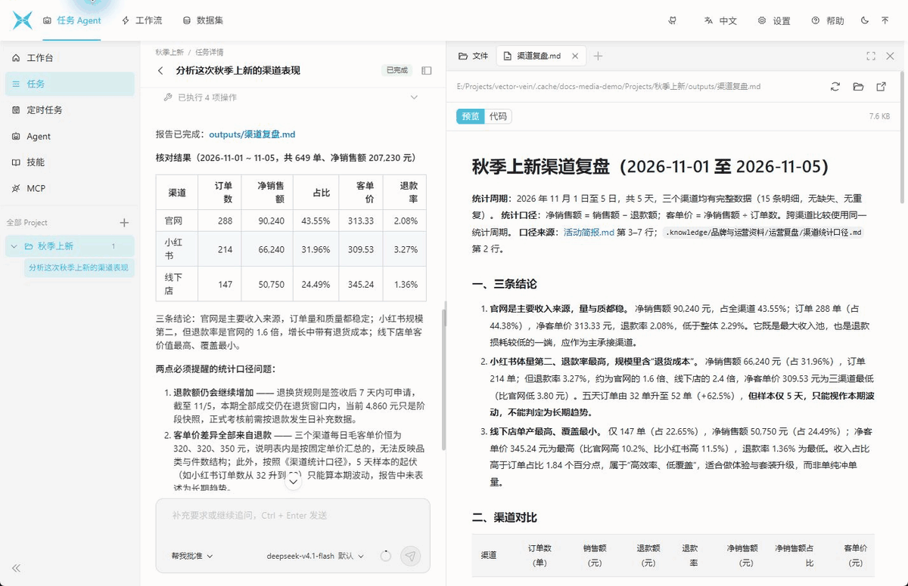
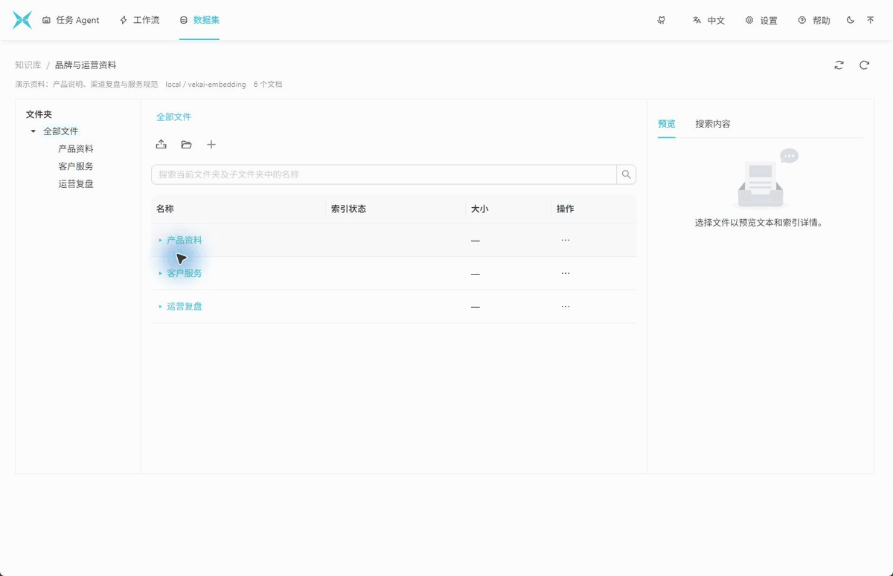
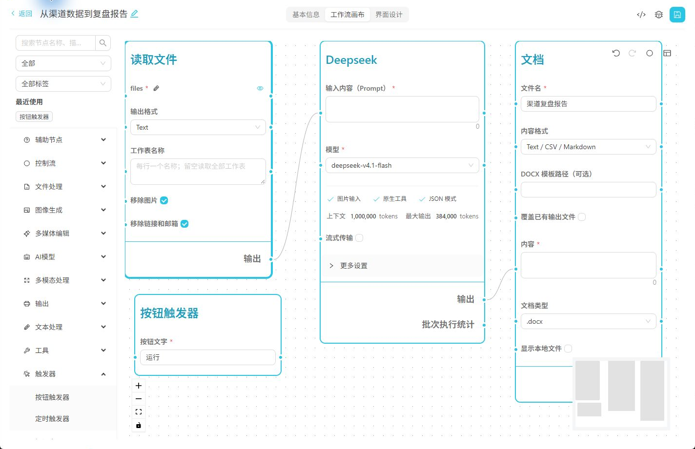

[English](README.md) | 简体中文 | [日本語](README_ja.md)

<a href="https://vectorvein.com"></a>

# 向量脉络 VectorVein

**运行在本地桌面上的任务 Agent 与可视化工作流工具。**

日常工作里，很多事情需要同时翻阅本地几个文件夹、对照既定文档口径、跑一段数据统计，最后落成一份有据可查的报告或表格。VectorVein 将自主执行任务的 Agent 与固定步骤的可视化工作流放在同一个桌面应用里：需要读文件、查资料、多步推进时直接向 Agent 下达目标；需要按固定规则反复批处理或生成标准文档时使用工作流，也可以把可用工作流直接挂载给 Agent 调用。


[下载桌面版 v1.0.2](https://github.com/AndersonBY/vector-vein/releases) · [安装与配置指南](docs/getting-started_zh.md) · [上手教程](TUTORIAL_zh.md) · [在线版](https://vectorvein.com) · [在线文档](https://vectorvein.com/help/docs/introduction)

---

## 用一个示例任务看它怎么工作

以下方截图中的“秋季上新渠道复盘”示例任务为例：本地项目目录中放着活动简报与 5 天的渠道销售及退款明细，知识库中存放着跨渠道统计口径与退换货规则。我们只需让 Agent“分析这次秋季上新的渠道表现，结合知识库里的统计口径整理一份包含渠道对比、结论和下一步建议的报告，保存到 `outputs/` 并附上引用来源”。

Agent 读取本地数据并检索知识库口径后，核算出 5 天内共 649 笔订单、207,230 元净销售额的各渠道表现，将生成的 `outputs/渠道复盘.md` 写入项目目录。任务完成后，可以在右侧工作区直接预览报告与源码、切换本地文件，或点开引用的知识库文档核对原文。



---

## 核心功能

### 任务工作区与多目录 Project

启动应用后默认进入任务 Agent 工作台。你可以将本机的一个或多个文件夹建为一个 Project（首个目录作为默认工作目录，其余作为附加允许目录），让 Agent 在授权范围内跨目录搜索和读写项目文件；也可以不绑定 Project 直接发起独立任务。

进入任务详情页后，对话流与右侧多标签工作区并排展示。生成的代码、Markdown 报告、命令输出、工具结果以及模型按需维护的任务计划都可以分标签打开。任务运行或等待期间，依然可以随时在底部切换模型、推理强度和审批模式（每次询问 / 自动风险审查 / 完全允许）。


### 层级知识库与混合检索

数据空间内置了层级知识库，同时保留原有的关系数据库管理。你可以按文件夹层级导入 PDF、Word、Excel、PPT、Markdown、CSV 等常见文档；程序会将源文件复制到受管存储中提取文本并建立本机索引，不会修改或删除你原有的本地文件。

知识库直接内置本机 Qdrant 向量索引与全文检索，无需单独部署外部向量数据库，并可在设置中一键接入本地 [Vekai](https://github.com/AndersonBY/vekai) 嵌入与重排序服务。挂载知识库后，Agent 既能调用专用检索工具，也能通过只读的 `.knowledge/` 虚拟路径直接读取和预览文档提取文本。




### Skills、MCP 与工作流工具扩展

你可以为不同工作角色保存专属的 Agent 预设，在 Agent 的“工具与能力”面板中按需组合知识库与三类扩展能力：

- **Skills 技能包**：支持在应用内直接编写 `SKILL.md`，或从本机 `~/.agents/skills`、`~/.codex/skills`、`~/.claude/skills` 目录扫描导入已有技能。
- **MCP 服务接入**：支持连接本地或远程 MCP 服务，先测试连接发现工具，再按需勾选启用具体工具。
- **挂载可用工作流**：工作流空间中状态有效（Valid）的工作流可直接挂载为 Agent 工具，由 Agent 按输入参数发起调用并关联运行记录。


### 定时任务与后台运行

需要定期执行的巡检、日报或数据汇总，可以在定时任务页面通过可视化周期编辑器设定运行时间，无需手写 Cron 表达式。你可以选择每次创建新任务，或在同一个已有任务中延续上下文继续执行，并按需开启完成后自动隐藏与系统桌面通知。在 Windows 系统下，关闭窗口可最小化到系统托盘，保持后台调度与索引继续运行。


### 可视化工作流与结构化文档输出

当业务流程步骤固定、需要反复执行时，可以在工作流画布中通过拖拽节点搭建流水线。工作流支持读取保留来源行号的多工作表 Excel、为大语言模型节点配置 JSON Schema 输出校验与结果缓存，并直接导出带格式的多表 `.xlsx`、结构化 `.docx` 文档以及 `.png` 图表。

除了在桌面界面运行，所有工作流都可以通过内置的本地 HTTP API（默认 `http://127.0.0.1:8787`）或随包附带的 `VectorVeinCLI` 命令行工具直接调用。



---

## 快速开始

1. **下载运行**：前往 [GitHub Releases](https://github.com/AndersonBY/vector-vein/releases) 下载对应系统的 `v1.0.2` 压缩包（`vector-vein-windows-v1.0.2.zip`、`vector-vein-mac-v1.0.2.zip` 或 `vector-vein-linux-v1.0.2.zip`），解压后运行 `VectorVein`。桌面界面支持简体中文与英文切换。
2. **配置模型**：打开右上角 **设置**，在 API 端点中配置你常用的云端模型服务（如 OpenAI、DeepSeek、Anthropic、Gemini、通义千问等）或本机推理服务（Ollama、LM Studio、vLLM），点击 **测试** 验证连通后保存。（应用数据默认保存在本地 `data/` 目录；当你在任务或工作流中选用云端模型或外部服务时，对应请求内容会发送至所选服务商。）
3. **开始使用**：如需挂载知识库或技能，可在左侧 **Agent** 页面编辑或新建 Agent 预设；回到 **工作台** 后，选择目标 Project（可选）、Agent 与模型预设，输入目标即可开始。详细步骤请参考 [安装与配置指南](docs/getting-started_zh.md) 与 [上手教程](TUTORIAL_zh.md)。

> [!IMPORTANT]
> **从 0.x 旧版本升级提示**：升级前请先完全退出旧版程序（含系统托盘进程）。1.0 首次启动时会先将原 `data` 目录自动打包为同级 ZIP 备份并校验，校验通过后才会执行数据迁移；若备份或校验失败则会立即中止升级。升级完成后，旧版对话 Agent 历史会从当前活动库移除（完整保留在备份 ZIP 中），原有关系数据库继续保留，旧向量数据集会导入为知识库。详见 [升级说明](docs/getting-started_zh.md#2-从-0x-升级到-10-系列)。

---

## 专题文档与开发指南

- **安装与教程**：[安装、模型配置与升级指南](docs/getting-started_zh.md) · [快速上手教程](TUTORIAL_zh.md) · [窗口与系统托盘](docs/desktop-window.md)
- **任务 Agent 与知识库**：[任务 Agent 运行时](docs/task-agent-runtime.md) · [Skills 与 MCP 集成](docs/task-agent-skills-mcp.md) · [知识库与 Vekai 检索](docs/knowledge-bases.md) · [Agent 定时任务](docs/task-agent-scheduling.md) · [模型选择与预设](docs/model-selection.md) · [端点在线测试](docs/model-endpoint-test.md)
- **可视化工作流与 CLI**：[结构化数据工作流](docs/reliable-workflows.md) · [CLI 命令行工具](docs/cli.md) · [节点时间线](docs/workflow-timeline.md) · [运行产物列表](docs/workflow-artifacts.md) · [画布只读预览](docs/workflow-preview.md) · [协作式停止](docs/workflow-stopping.md) · [异常恢复](docs/workflow-recovery.md) · [失败诊断](docs/workflow-failures.md) · [人工反馈续跑](docs/workflow-feedback.md) · [周期调度器](docs/workflow-scheduling.md) · [HTTP 请求节点](docs/http-request-node.md) · [联网搜索设置](docs/web-search.md)
- **版本记录**：[v1.0.2](docs/releases/1.0.2.md) · [v1.0.1](docs/releases/1.0.1.md) · [v1.0.0](docs/releases/1.0.0.md)

### 源码开发

本地开发需要 **Python `>=3.12, <3.13`**（配合 [PDM](https://pdm.fming.dev/latest/#installation)）、**Node.js 22** 与 **pnpm 10**。

```bash
cd frontend && pnpm install
cd ../backend && cp .env.example .env
pdm install          # macOS 请运行: pdm install -G mac
pdm run build-front
pdm run dev
```

测试、代码检查、数据库迁移与打包发布流程详见 **[开发、测试与构建发布指南](docs/development_zh.md)**。

---

## 许可证

向量脉络（VectorVein）基于 **VectorVein License** 授权发布，仅供非商业研究用途（solely for non-commercial research purposes）。完整授权条款与限制请参阅 [LICENSE](LICENSE.md)。