English | [简体中文](TUTORIAL_zh.md) | [日本語](TUTORIAL_ja.md)

# VectorVein Hands-On Tutorial

Once you have completed the [Setup & Model Configuration](docs/getting-started.md), this walkthrough guides you through the two core ways of working in VectorVein 1.0:

1. **Part 1: Completing local tasks with Task Agents, Multi-Folder Projects, and Knowledge Bases**
2. **Part 2: Building a Visual Workflow from scratch—and attaching it to an Agent as a callable tool**

You can also try the web-based [Interactive Workflow Tutorial](https://vectorvein.com/workspace/workflow/tutorial) anytime.

---

## Part 1: Working with Task Agents, Projects & Knowledge Bases

### 1. Create a Multi-Directory Project (Optional)

When your work spans more than one folder on disk (for example, a campaign data folder plus an archive folder, or a frontend repository plus a backend repository), start by creating a **Project**:

1. In the left **Task Agent sidebar**, click the `+` button next to **Projects**.
2. Use the native folder picker to select one or more local directories:
   - The **first directory** becomes the default working directory where new files are written by default.
   - Any **additional directories** are mounted as allowed roots that the Agent can read and search across.
3. You can also leave the Project selector empty on the Workbench to run a standalone task.


### 2. Import a Knowledge Base & Mount It on an Agent Profile

If you have reference documents you consult repeatedly—such as reporting definitions, service rules, PDF contracts, Excel ledgers, or Markdown docs—store them in a **Knowledge Base** and bind them to an Agent profile:

1. Click **Data** in the top navigation bar, create a new **Knowledge Base**, and choose an embedding model configured in Settings (or your local [Vekai](https://github.com/AndersonBY/vekai) service).
2. Create folders inside the knowledge base and import files or entire directory trees. VectorVein automatically extracts text, chunks content, and indexes it in the built-in local Qdrant store and full-text search.


3. Return to **Task Agent -> Agent** to view the built-in General Agent or create specialized Agent profiles for recurring roles:

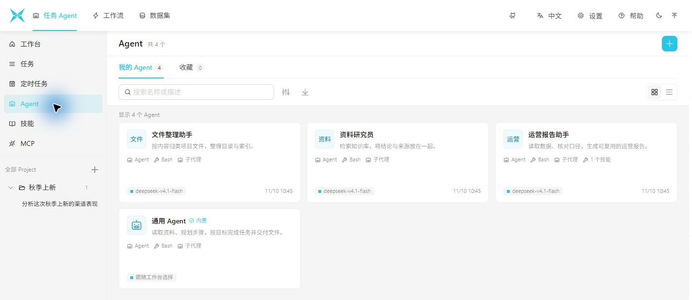

4. Open an Agent profile and use the **Tools & Capabilities** panel to mount Knowledge Bases, local Skills, valid workflows, or MCP tools:


### 3. Pick an Agent, Launch a Task & Inspect Results Side by Side

1. On the **Workbench**, click the Project and Agent selectors above the input box. The **Select Agent** modal lets you search profiles, filter by capability, and preview the selected Agent's model, permissions, and instructions:

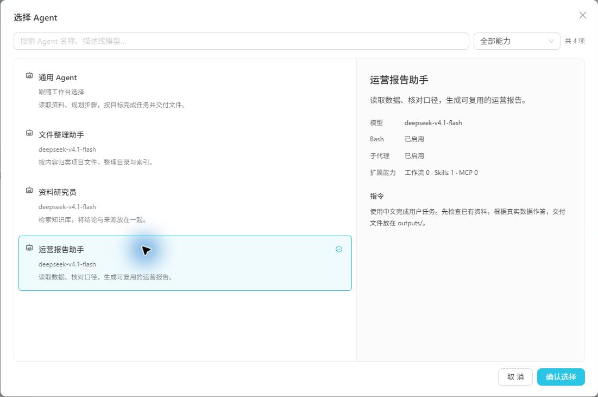

2. Verify the **Model / Reasoning Effort** and **Approval Mode** in the bottom bar, then enter a concrete goal and send it—for example:
   > "Analyze the channel performance for this autumn launch using the reporting definitions in the knowledge base, compile a report with channel comparisons, conclusions, and next steps, save it to `outputs/`, and cite your sources."
3. Submitting the task opens the **side-by-side Task Detail view**:
   - **Left conversation & execution stream**: Follow the Agent's tool calls, any task plan it maintains as needed, inline confirmation forms, and the final summary (such as the 649 orders and ¥207,230 net sales calculated from the 5-day sample dataset).
   - **Right multi-tab workspace**: Click the generated `渠道复盘.md` tab or any cited `.knowledge/` file to preview rendered Markdown, switch to source view, or verify the original reference text right beside the conversation.
   - **Live adjustments**: Switch models, reasoning effort, or approval modes from the bottom bar while the task is running or waiting for input.


### 4. Import Skills, Connect MCP Servers, or Schedule Runs

- **Import Local Skills**: Open **Skills** in the left sidebar, click Import, and choose **Local Agents** to scan and import existing skills from `~/.agents/skills`, `~/.codex/skills`, or `~/.claude/skills`.
- **Connect MCP Servers**: Open **MCP**, save a server configuration, click **Test connection** to discover tools, and enable the tools you want.
- **Schedule Recurring Tasks**: Open **Schedules** to configure whether each trigger creates a new task or continues inside an existing task, set the repeat timetable visually, and optionally hide completed tasks or send a desktop notification.


---

## Part 2: Building a Visual Workflow from Scratch (and Attaching It to an Agent)

When a process follows a fixed sequence of steps—such as scraping a web page, formatting a prompt, and generating both a Markdown summary and a mind map, or reading files and exporting a formatted `.docx` report—a **Visual Workflow** lets you lock in the pipeline for repeatable execution.

### 1. Core Workflow Design Principles

#### Separate the Run Interface from the Editor Canvas

Every workflow has two views: the **Editor Canvas** where you wire nodes together, and the **Run Interface** used for day-to-day execution.

A simple rule of thumb: **Only expose inputs that change from run to run (such as a target URL or input file) by enabling their eyeball icon. Keep static prompt templates and fixed parameters inside the canvas.**

In the comparison below, the right-hand Run Interface is much cleaner because static template instructions remain hidden inside the canvas:

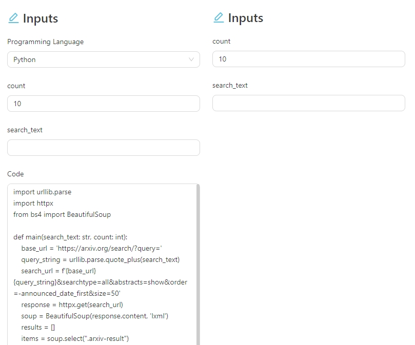

#### Build and Test Incrementally

Start with two or three nodes, save, and test-run before adding the next stage. Incremental testing makes it easy to verify data flow at every step.

---

### 2. Step-by-Step: Web Scraper + AI Mind Map Workflow

Let's build a complete workflow that scrapes an article URL, summarizes it with an LLM, and outputs both Markdown text and an interactive mind map.

#### Step 1: Add a Trigger and a Text Output Node

1. Open the **Workflow** space, create a new blank workflow, and click **More Actions -> Edit** to open the canvas.
2. Drag **Triggers -> Button Trigger** from the left sidebar onto the canvas.
3. Drag **Output -> Text** onto the canvas. Enter `Hello` in `Text Content` and `Output Title` in `Text Header`.

Your canvas should look like this:
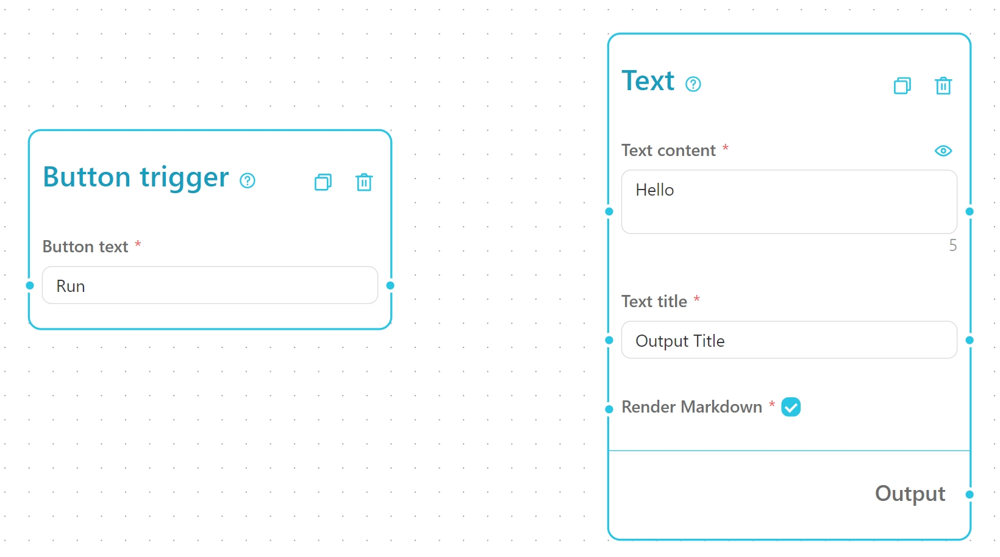

> **Note**: **Button Trigger** simply sits on the canvas and does not need to be wired to other nodes. The `Text Header` field labels the output section when multiple outputs are displayed.

Click **Interface Design** at the top to preview the Run Interface:
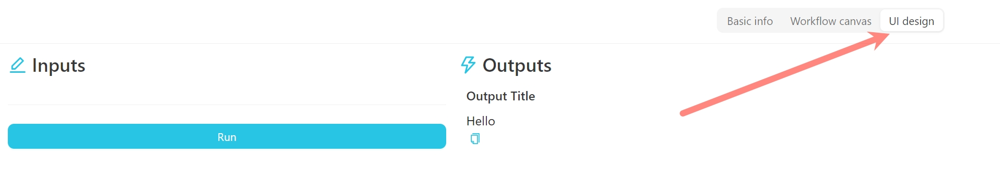

#### Step 2: Combine Variables with Template Compose

1. Switch back to the **Workflow Canvas** and drag in **Text Processing -> Template Compose**:
   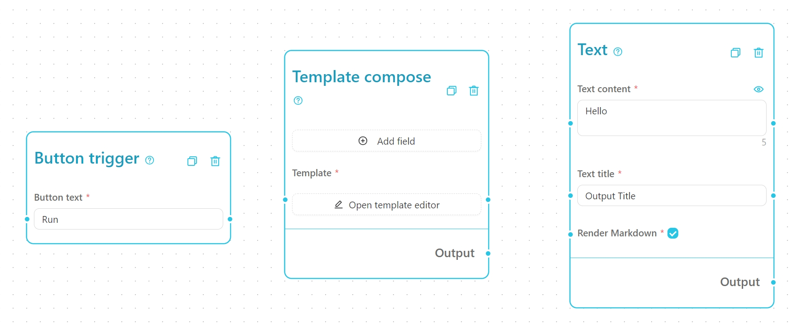
2. Click **Add Field** on the **Template Compose** node to add a single-line `Title` variable and a multi-line `Body` variable:
   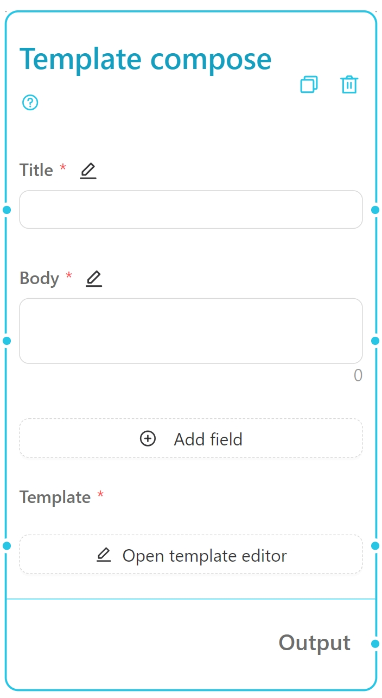
3. Reference variables in the template using `{{variable_name}}` (or drag variable tags directly into the template box):
   ```markdown
   # {{Title}}
   ---
   {{Body}}
   ```
   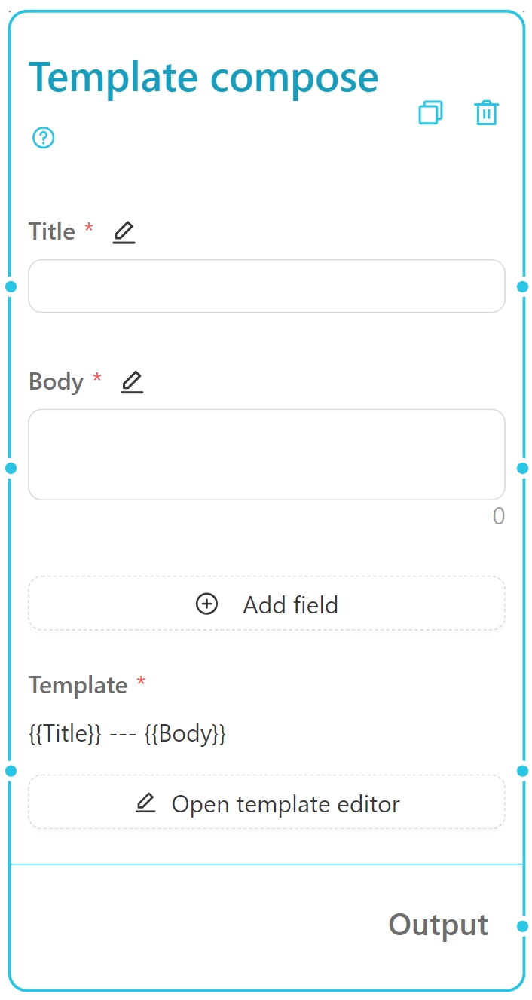
4. Drag a connection from the output handle of **Template Compose** to the `Text Content` input handle of the **Text** node:
   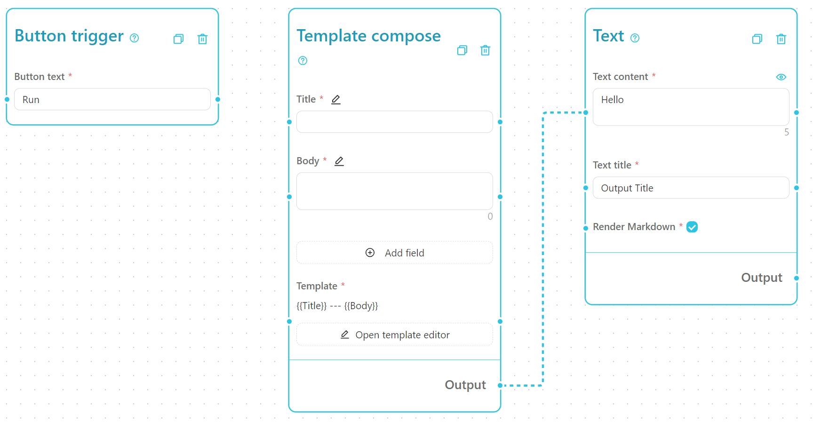
5. Enable the **eyeball** icons next to `Title` and `Body`, click **Save**, and test-run the workflow in the Run Interface:
   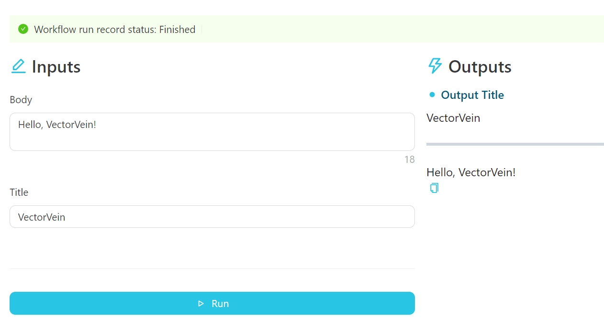

> **Note**: Because **Template Compose** is now connected to the **Text** node's `Text Content` handle, the connected output overrides the static `Hello` default.

#### Step 3: Connect a Web Text Crawler

1. Reopen the editor canvas and drag in **Web Crawlers -> Text Crawler**.
2. Connect the crawler's webpage title and body outputs to `Title` and `Body` on **Template Compose**, and turn off the eyeball icons on **Template Compose** (leaving only the crawler's URL input visible in the Run Interface):
   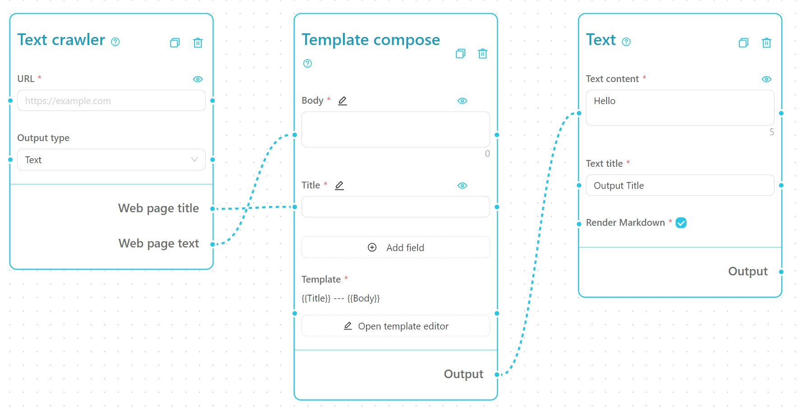
3. Click **Save**, enter an article URL (for example, [What is Azure OpenAI Service?](https://learn.microsoft.com/en-us/azure/ai-services/openai/overview)), and click **Run**:
   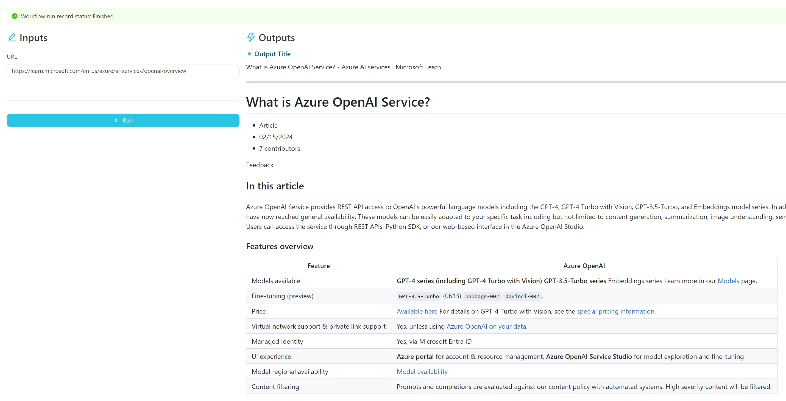

#### Step 4: Add an LLM Node and Mind Map Output

1. Reopen the editor and update **Template Compose** so it formats a prompt for the model:
   ```markdown
   # {{Title}}
   {{Body}}

   ---

   Summary:
   ```
2. Drag an **LLM** node (such as Universal LLM, DeepSeek, or OpenAI) onto the canvas between **Template Compose** and **Text**.
3. Rewire the connection from **Template Compose** into the LLM node's `Input Prompt` handle, then connect the LLM output to the **Text** node (you can also delete any selected edge with `Backspace`):
   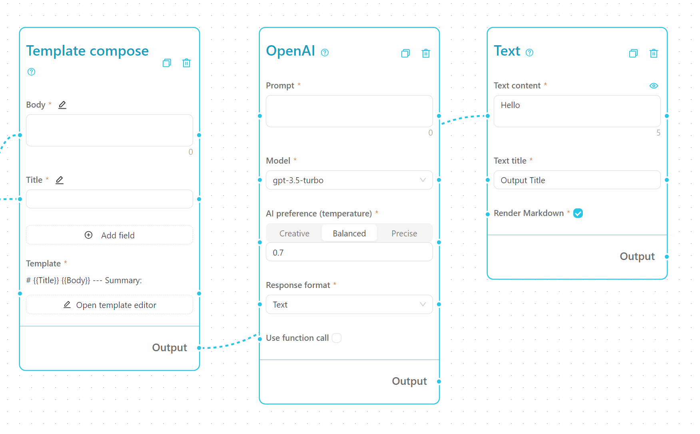
   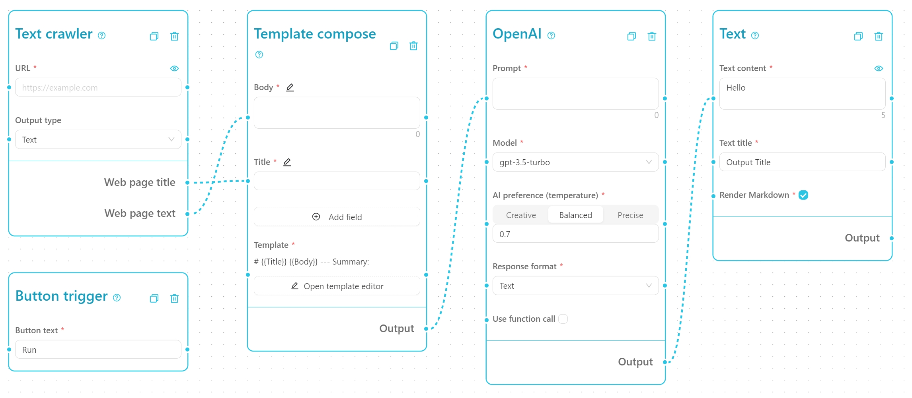
4. Save and run the workflow with an article URL to verify the AI summary:
   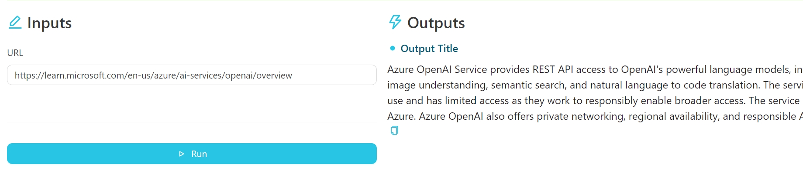
5. Back in the editor, drag **Output -> Mind Map** onto the canvas and connect a second line from the LLM node's output handle to the **Mind Map** node's `Markdown Content` handle:
   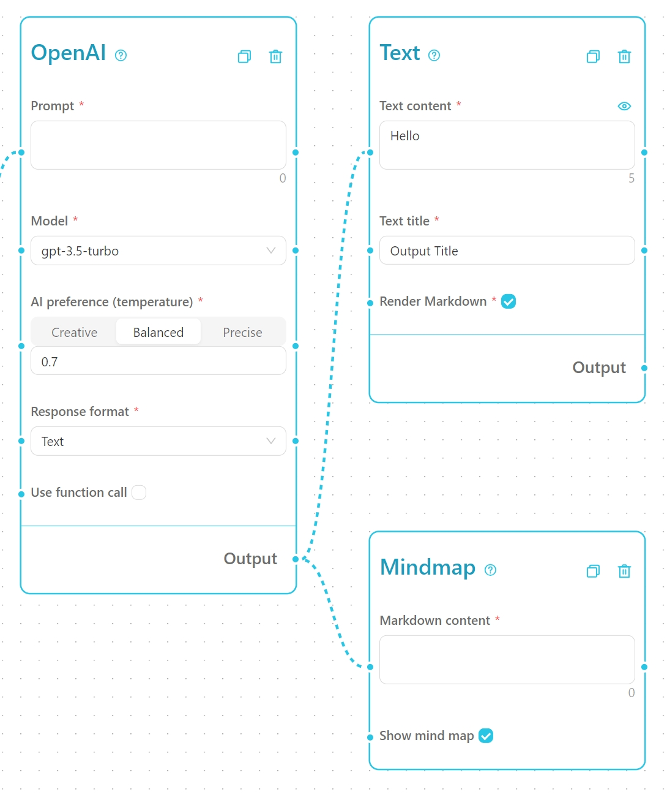
6. Update the **Template Compose** prompt to request a multi-level Markdown mind map:
   ```markdown
   {{Title}}
   {{Body}}

   ---

   Please summarize the above article into a multi-level mind map using Markdown format.
   ```
7. Save and run again to get both the Markdown outline and an interactive mind map:
   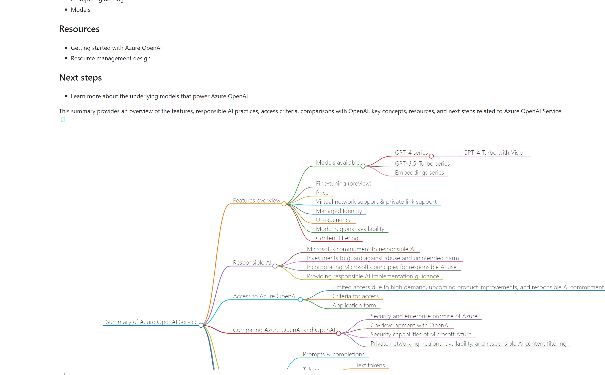
8. Finally, give your workflow a clear name, tags, and description in the top-left corner:
   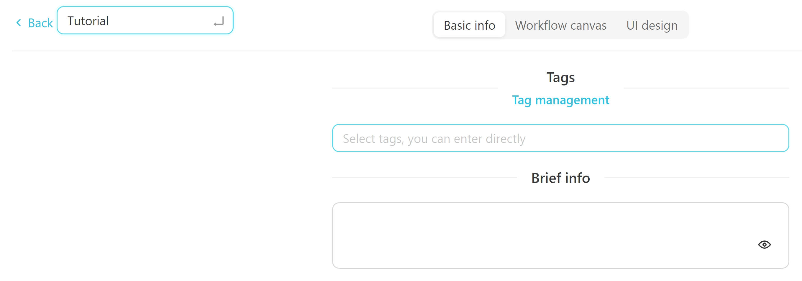

---

### 3. Next Step: Attach Your Workflow to a Task Agent

Once saved in a valid (`VALID`) state, your workflow can be triggered from the desktop UI, a visual schedule, the local HTTP API (`http://127.0.0.1:8787`), `VectorVeinCLI`, or **directly by a Task Agent**:

1. Open **Task Agent -> Agent** and select your Agent profile.
2. Under **Tools & Capabilities -> Callable Workflows**, check the valid workflow you created and save.
3. Next time you ask the Agent to process a list of URLs or run that pipeline, it can invoke the workflow with structured inputs and link the run record directly inside your task detail view.