[English](TUTORIAL.md) | [简体中文](TUTORIAL_zh.md) | 日本語

# VectorVein クイックスタート実践チュートリアル

[セットアップ・モデル設定 (EN)](docs/getting-started.md)（[中国語版](docs/getting-started_zh.md)）が完了したら、このガイドに沿って VectorVein 1.0 の 2 つのコアな使い方を体験してみましょう。

1. **パート 1：「タスク Agent ＋ Project ＋ ナレッジベース」でローカル業務とドキュメント作成を完遂する**
2. **パート 2：ゼロから「ビジュアルワークフロー」を構築し、Agent の専用ツールとして連携する**

ブラウザ上で試せる [オンラインインタラクティブチュートリアル](https://vectorvein.com/workspace/workflow/editor/tutorial) もあわせてご活用ください。

---

## パート 1：タスク Agent・Project・ナレッジベースの活用

### 1. 複数ディレクトリ対応 Project の作成（任意）

作業が複数のローカルフォルダ（例：「キャンペーンデータフォルダ ＋ 過去アーカイブフォルダ」や「フロントエンドリポジトリ ＋ バックエンドリポジトリ」）にまたがる場合は、まず **Project** を作成します。

1. 左側の **タスク Agent サイドバー** 下部にある **Project** の `+` ボタンをクリックします。
2. OS のフォルダ選択ダイアログから 1 つ以上のローカルフォルダを追加します：
   - **最初のフォルダ** がタスク実行時の既定作業ディレクトリとなり、生成ファイルは既定でここに保存されます。
   - **2 つ目以降のフォルダ** は追加の許可ルートとしてマウントされ、Agent が横断的に検索・読み取りを行えます。
3. Project を選択せず、ワークベンチから単発タスクを直接開始することも可能です。


### 2. 階層型ナレッジベースの作成と Agent プロファイルへのマウント

繰り返し参照する資料（集計定義、サービス規約、PDF 仕様書、Excel 台帳、Markdown マニュアルなど）は **ナレッジベース** に登録し、Agent プロファイルに紐付けておくと効果的です。

1. 上部ナビゲーションの **データ空間（Data）** を開き、**ナレッジベース** タブで新規作成し、設定済みの埋め込みモデル（またはローカル [Vekai](https://github.com/AndersonBY/vekai) サービス）を選択します。
2. フォルダ階層を作成し、ファイルやディレクトリごとインポートします。テキスト抽出・チャンク分割が自動で行われ、内蔵ローカル Qdrant と全文検索にインデックスが作成されます。


3. **タスク Agent -> Agent** 一覧画面に戻ると、内蔵の汎用 Agent のほか、用途別に作成したカスタム Agent プロファイルを確認・管理できます：

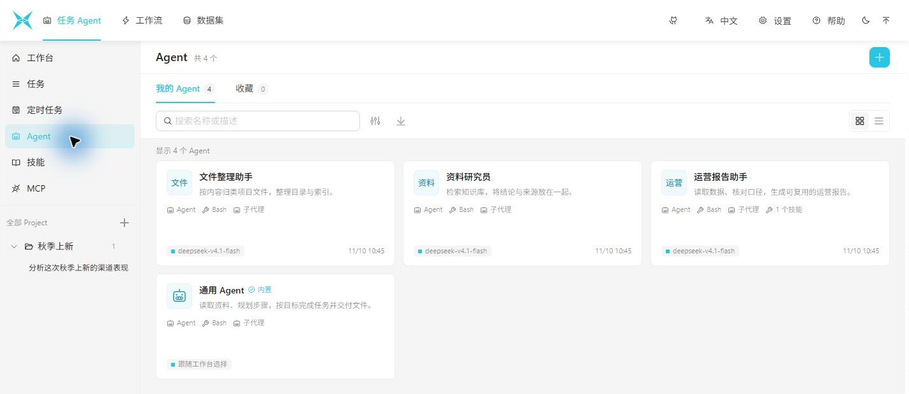

4. 使用する Agent プロファイルの編集画面を開き、**ツールと能力** パネルで対象のナレッジベース、ローカル Skill、有効なワークフロー、または MCP ツールを選択します：


### 3. Agent の選択・タスクの開始・マルチタブでの成果物確認

1. **ワークベンチ** に戻り、入力欄の上にある Project と Agent のセレクターをクリックします。**Agent の選択** モーダルでは、名前や能力で検索し、右側でモデル・権限・指示内容をプレビューして選択できます：

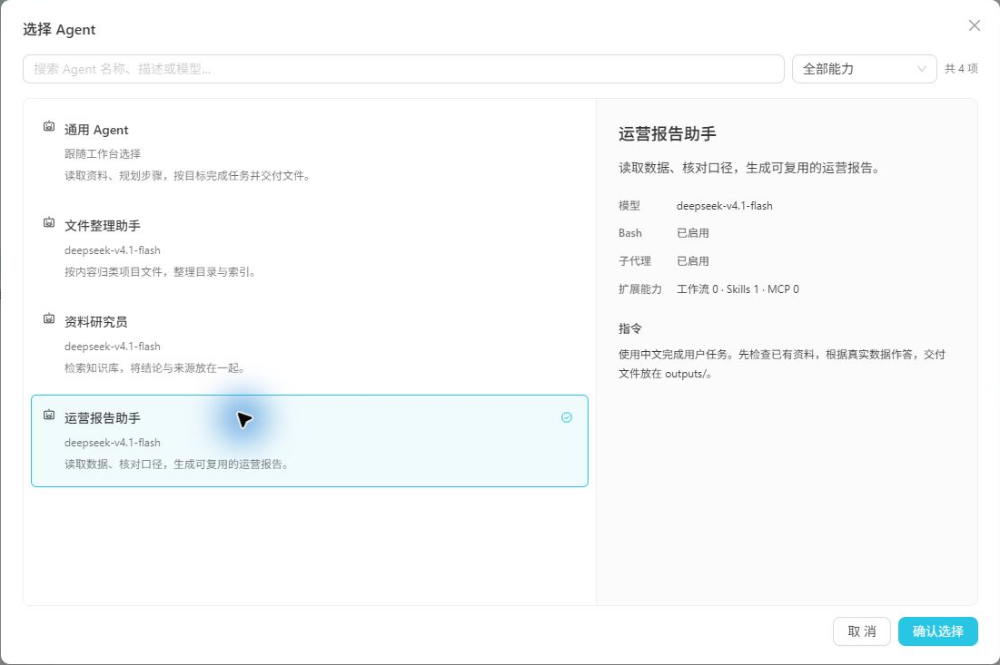

2. 下部のコンポーザーで **モデル／推論強度** と **承認モード** を確認し、具体的な目標を入力して送信します。例：
   > 「ナレッジベースの集計定義に基づき、今回の秋の新作のチャネル別実績を比較・分析し、結論と次のアクションを含むレポートを `outputs/` に保存して引用元を明記してください。」
3. 送信すると、**左右分割のタスク詳細画面** に移動します：
   - **左側の会話・実行ストリーム**：ツール呼び出しの進捗、モデルが必要に応じて作成・更新するタスクプラン、確認フォーム、および最終的な集計結果（5 日間のサンプルデータから算出された 649 件の注文・純売上 207,230 元の比較表など）が表示されます。
   - **右側のマルチタブ・ワークスペース**：生成された `渠道复盘.md` タブや参照された `.knowledge/` 文書パスをクリックすると、会話のすぐ隣で Markdown のプレビュー、コード表示への切り替え、引用元の原文確認が行えます。
   - **実行中の切り替え**：タスクの実行中や待機中でも、下部からモデルや推論強度、承認モードを変更できます。


### 4. Skills・MCP・定期スケジュールの活用

- **ローカル Skills の一括インポート**：左サイドバーの **Skills** からインポートを開き、**Local Agents** を選ぶと、`~/.agents/skills`、`~/.codex/skills`、`~/.claude/skills` にある既存の Skill をスキャンして取り込めます。
- **MCP サーバー連携**：**MCP** 画面でサーバー設定を保存し、**接続テスト** を実行してツールを検出・有効化すると、Agent から外部 MCP ツールを呼び出せます。
- **定期スケジュール実行**：左サイドバーの **スケジュール** から、「毎回新規タスクを作成」または「同じタスクを継続」を選択し、ビジュアルタイムテーブルで繰り返し周期を設定できます。**完了後のタスク非表示** や **完了後の通知送信** も切り替えられます。


---

## パート 2：ビジュアルワークフローをゼロから作成する（Agent 連携対応）

手順が決まっている定型処理（例：「Web 記事を取得 -> 定型プロンプトに合成 -> Markdown 要約とマインドマップを同時出力」や「ファイル読み込み -> モデル処理 -> `.docx` 帳票出力」）には **ビジュアルワークフロー** が適しています。

### 1. ワークフロー設計の基本的な考え方

#### 使用画面と編集画面を分ける

各ワークフローには、ノードをつなぐ **編集画面（キャンバス）** と、日常的に実行するための **使用画面** があります。

設計のコツはシンプルです：**実行するたびに変わる項目（URL や入力ファイルなど）だけ「目」のアイコンをオンにして使用画面に表示し、毎回変わらないプロンプトテンプレートや固定パラメータはキャンバス内に隠しておくこと** です。

下の比較図では、右側の設計のほうが日常的に迷わず使えるすっきりした画面になっています。

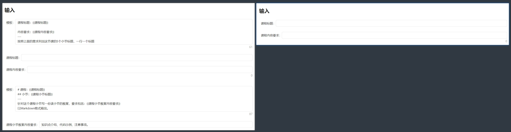

#### 小さく作って段階的にテストする

最初からすべてのノードをつなぐのではなく、2〜3 個のノードをつないだら一度保存してテスト実行し、出力を確認しながら段階的に拡張していくとスムーズです。

---

### 2. 実践：「Web スクレイピング ＋ AI 多階層マインドマップ」ワークフローの作成

#### ステップ 1：トリガーとテキスト出力ノードを配置する

1. 上部の **ワークフロー** 空間で新しい空のワークフローを作成し、詳細ページで **【その他の操作】 -> 【編集】** をクリックします。
2. 左側のノード一覧から **トリガー -> ボタントリガー** をキャンバスにドラッグします。
3. **出力 -> テキスト** ノードをキャンバスにドラッグし、テキスト内容に `こんにちは`、テキストタイトルに `出力タイトル` と入力します。

現在のキャンバスは次のようになります：
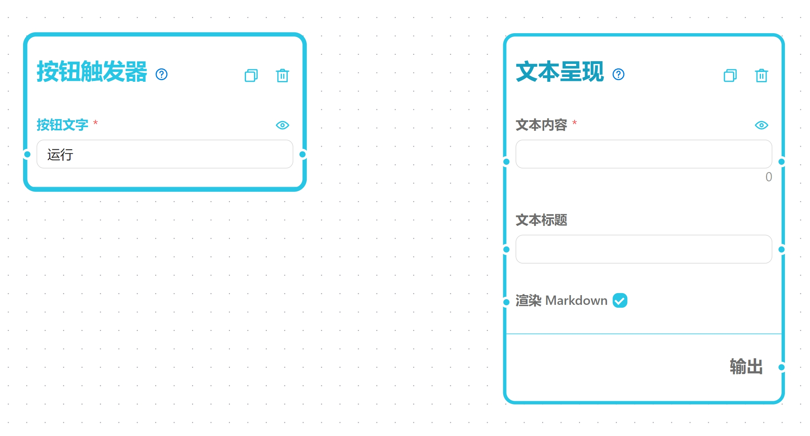

> **ヒント**：**ボタントリガー** はキャンバスに置いておくだけで機能し、他のノードと線でつなぐ必要はありません。**テキストタイトル** は複数の出力を区別するための見出しとして表示されます。

上部の **インターフェース設計** をクリックして使用画面をプレビューします：
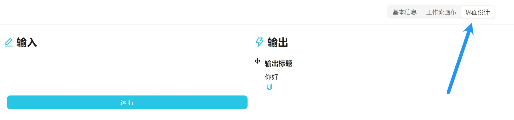

#### ステップ 2：「テンプレート合成」で変数を組み合わせる

1. **ワークフローキャンバス** に戻り、左側から **テキスト処理 -> テンプレート合成** ノードをドラッグします：
   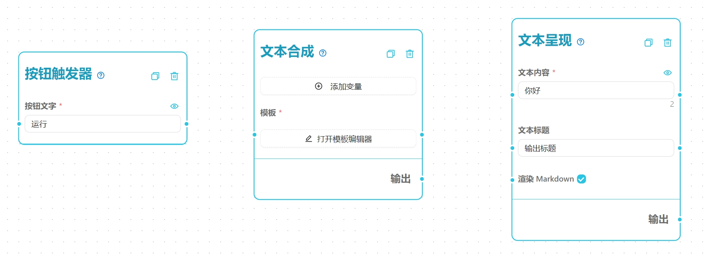
2. **テンプレート合成** ノードで変数を追加します。単一行の `タイトル` と、複数行入力の `本文` を追加します：
   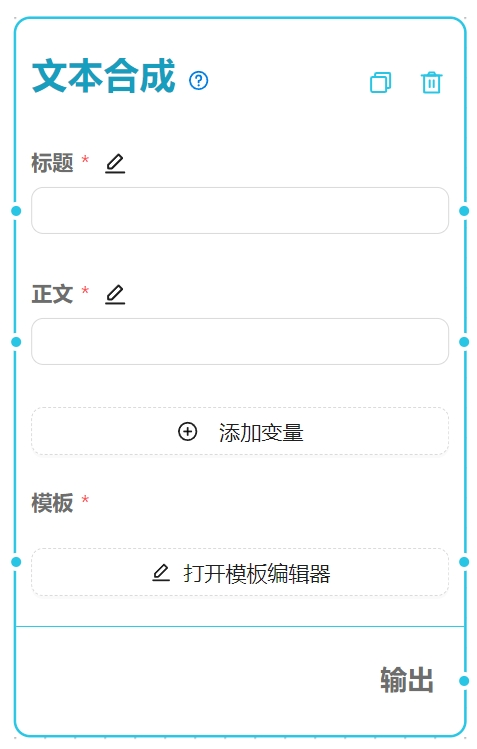
3. テンプレート欄に `{{変数名}}` 形式でフォーマットを記述します（変数タグをドラッグして挿入することも可能です）：
   ```markdown
   《{{タイトル}}》
   ---
   {{本文}}
   ```
   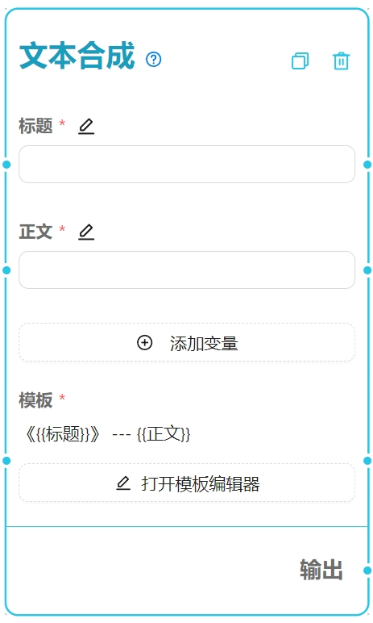
4. **テンプレート合成** の出力ハンドルから **テキスト** ノードの `テキスト内容` 入力ハンドルへ線を接続します：
   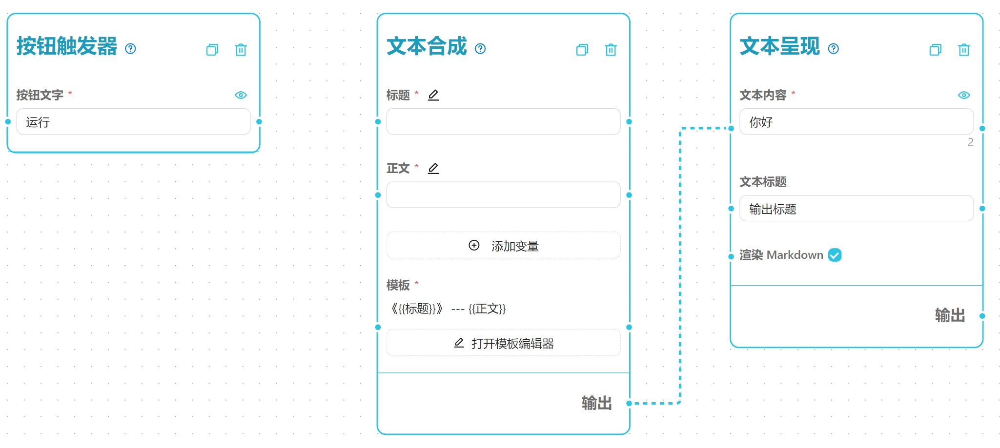
5. `タイトル` と `本文` の右側にある **目** のアイコンを有効にし、**保存** をクリックして使用画面からテスト実行してみます：
   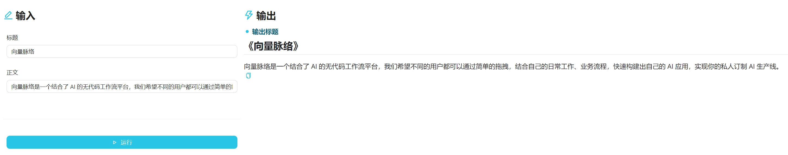

> **ヒント**：**テキスト** ノードの入力ハンドルに上流ノードの出力が接続されている場合、実行時には接続された出力が優先され、初期値の `こんにちは` は上書きされます。

#### ステップ 3：Web テキストクローラーを接続する

1. 再び編集画面を開き、**ウェブクローラー -> テキストクローラー** ノードをドラッグします。
2. **テキストクローラー** のタイトル出力・本文出力をそれぞれ **テンプレート合成** の `タイトル`・`本文` に接続し、**テンプレート合成** 側の **目** のアイコンをオフにします（クローラーの URL 入力のみを使用画面に残します）：
   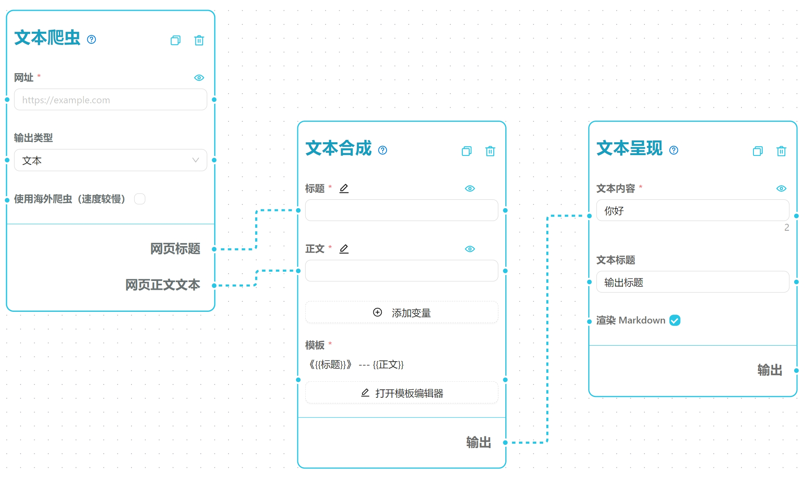
3. **保存** して使用画面に戻り、記事の URL（例：[What is Azure OpenAI Service?](https://learn.microsoft.com/en-us/azure/ai-services/openai/overview)）を入力して **実行** をクリックすると、取得した記事タイトルと本文が表示されます：
   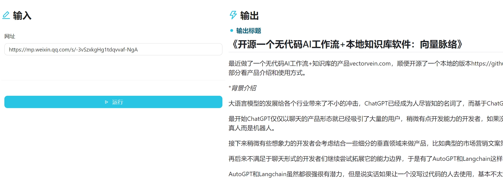

#### ステップ 4：LLM ノードとマインドマップ出力を追加する

1. 編集画面を開き、**テンプレート合成** の内容を AI へのプロンプトに変更します：
   ```markdown
   # {{タイトル}}
   {{本文}}

   ---

   要約：
   ```
2. 左側の **AI モデル** からモデルノード（汎用 LLM、DeepSeek、OpenAI など）をドラッグし、**テンプレート合成** と **テキスト** の間に配置します。
3. 接続線を付け替えます：**テンプレート合成** からの線を LLM ノードの `入力プロンプト` ハンドルへつなぎ直し、LLM ノードの出力を **テキスト** ノードに接続します（接続線を選択して `Backspace` キーで削除することもできます）：
   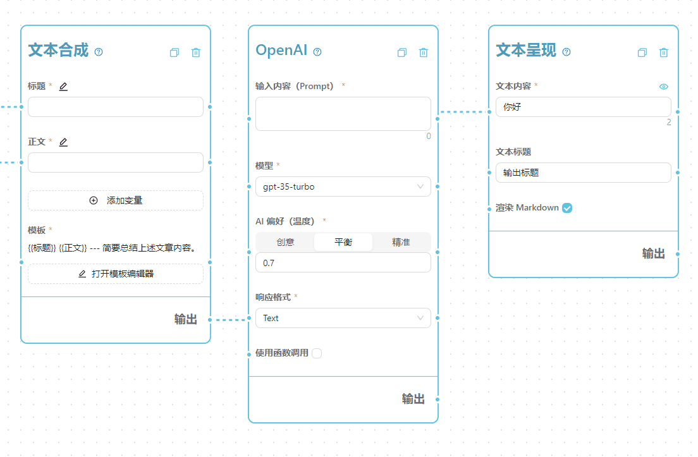
   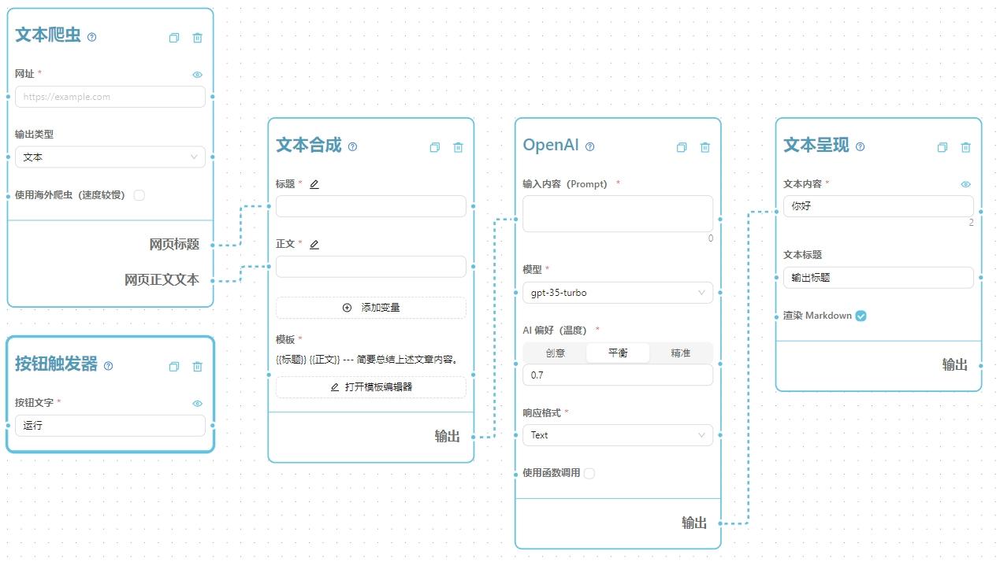
4. 保存して URL を入力し実行すると、AI が生成した要約が表示されます：
   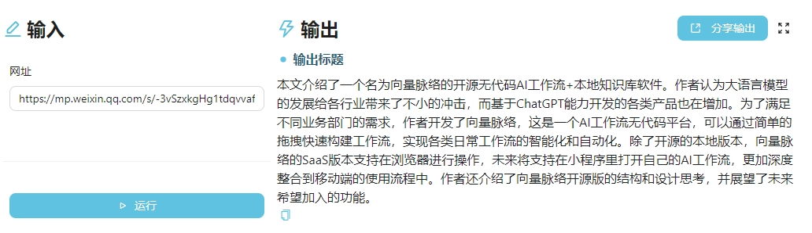
5. 編集画面に戻り、**出力 -> マインドマップ** ノードを追加し、LLM ノードの出力ハンドルからもう 1 本の線を **マインドマップ** ノードの `Markdown コンテンツ` ハンドルに接続します：
   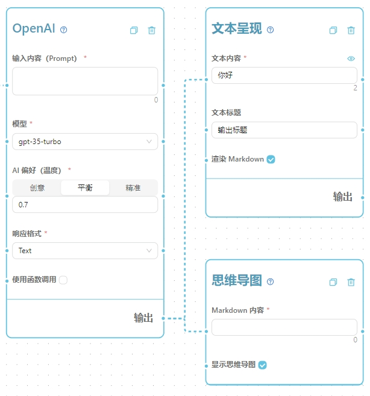
6. **テンプレート合成** のプロンプトを、多階層マインドマップを出力する指示に更新します：
   ```markdown
   {{タイトル}}
   {{本文}}

   ---

   上記の記事を多層階のマインドマップに要約し、Markdown 形式で日本語で出力してください。
   ```
7. 保存して再実行すると、Markdown テキストとインタラクティブなマインドマップの両方が生成されます：
   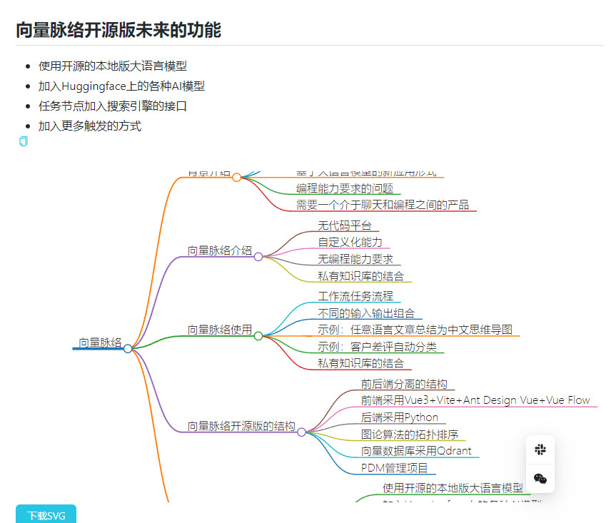
8. 最後に、左上からワークフローの名前・タグ・説明文を設定して保存しましょう：
   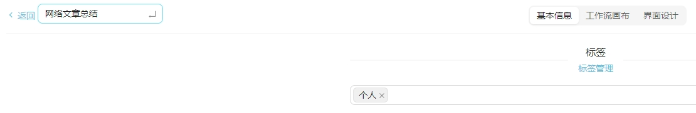

---

### 3. 応用：作成したワークフローをタスク Agent のツールにする

有効な状態（`VALID`）で保存されたワークフローは、使用画面での手動実行、スケジュール実行、ローカル HTTP API（`http://127.0.0.1:8787`）、`VectorVeinCLI` からの呼び出しに加えて、**タスク Agent の専用ツール** としても利用できます。

1. **タスク Agent -> Agent** を開き、Agent プロファイルの編集画面に入ります。
2. **ツールと能力 -> 呼び出し可能なワークフロー** タブで、保存済みの有効な（`VALID`）ワークフローにチェックを入れて保存します。
3. これにより、Agent とのタスク中に URL のリストを渡して処理を依頼すると、Agent がこのワークフローを呼び出し、実行結果と履歴をタスク詳細画面に紐付けてくれます。