[English](TUTORIAL.md) | 简体中文 | [日本語](TUTORIAL_ja.md)

# VectorVein 快速上手实战教程

在完成 [安装与模型配置](docs/getting-started_zh.md) 后，这篇指南将带你实操 VectorVein 1.0 的两大核心工作方式：

1. **第一部分：用“任务 Agent + Project + 知识库”完成本地项目与文档交付**
2. **第二部分：从零搭建一条“可视化工作流”，并将它挂载为 Agent 的专用工具**

你也可以随时体验网页端的 [在线互动教程](https://vectorvein.com/workspace/workflow/tutorial)。

---

## 第一部分：用任务 Agent 完成跨目录工作与知识检索

### 1. 创建多目录 Project（可选）

当你的工作涉及多个本地文件夹（例如“活动数据目录 + 历史归档目录”，或“前端仓库 + 后端仓库”）时，可以先创建一个 **Project**：

1. 在左侧 **任务 Agent 导航栏** 下方的 **全部 Project** 区域点击 `+` 新建按钮。
2. 通过系统文件夹选择器添加 1 个或多个本机目录：
   - **第一个目录**会作为任务执行时的默认工作目录，Agent 生成的新文件默认保存在这里。
   - **其余目录**会作为附加允许根目录挂载，Agent 可以跨目录搜索和读取。
3. 你也可以不选任何 Project，直接在工作台发起独立任务。

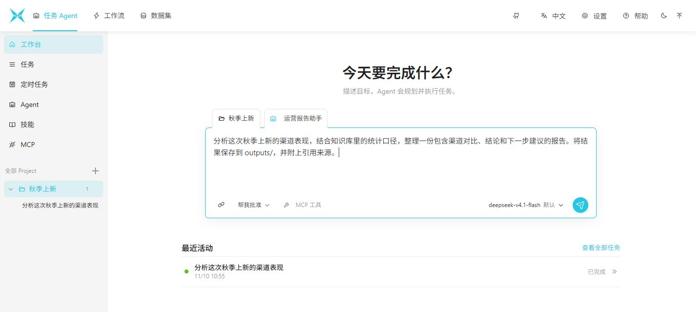

### 2. 导入层级知识库并挂载到 Agent 预设

如果你有一批需要反复查阅的参考资料（如统计口径、服务规范、PDF 合同、Excel 台账或 Markdown 手册），建议将它们放入**知识库**并绑定给常用 Agent：

1. 点击顶部导航栏的 **数据集（Data）**，在 **知识库** 标签页新建一个知识库，并选择你在设置中配置好的嵌入模型（或本地 [Vekai](https://github.com/AndersonBY/vekai) 服务）。
2. 在知识库详情页中创建文件夹层级，点击导入文件或导入整个目录。系统会自动提取文本、切分段落并在本机内置 Qdrant 与全文检索中建立索引。

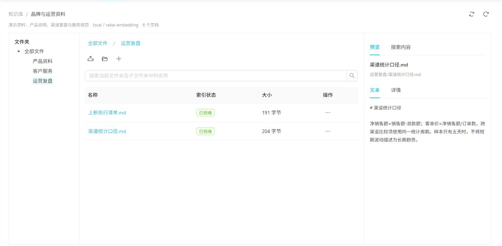

3. 回到 **任务 Agent -> Agent** 列表页，你可以查看内置的通用 Agent，或为特定工作场景新建专属 Agent（例如“文件整理助手”、“资料研究员”、“运营报告助手”）：

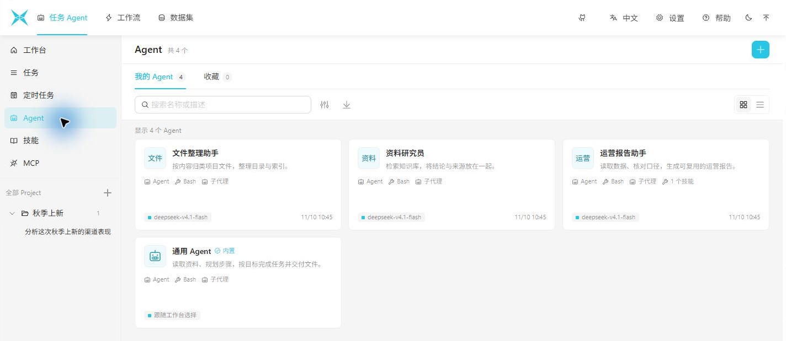

4. 进入某个 Agent 的编辑页，在 **工具与能力** 面板中勾选需要挂载的知识库、本地技能（Skills）、有效工作流或 MCP 工具：

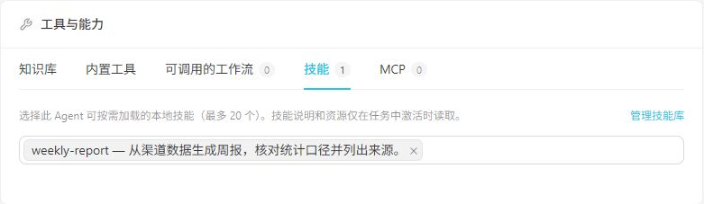

### 3. 选择 Agent、发起任务与并排工作区查看结果

1. 回到 **工作台**，点击输入框上方的 Project 与 Agent 选择器。在弹出的 **选择 Agent** 窗口中，可以按名称或能力筛选，并在右侧预览该 Agent 的模型、权限与指令详情：

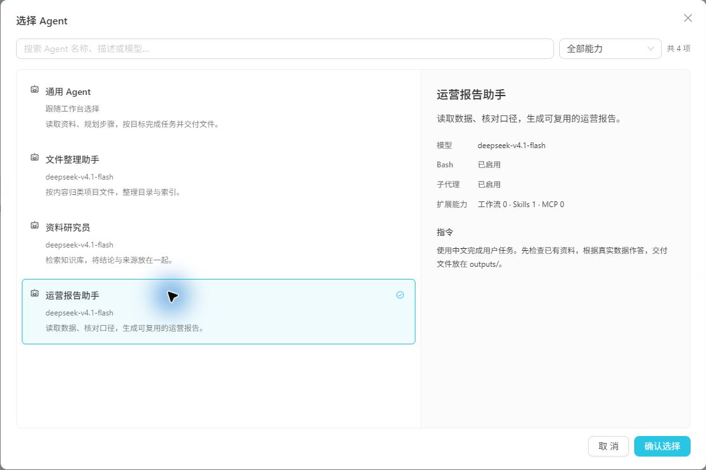

2. 在输入框底部确认本次使用的 **模型 / 推理强度** 以及 **审批权限（帮我批准 / 每次询问 / 完全访问）**，输入任务目标并发送，例如：
   > “分析这次秋季上新的渠道表现，结合知识库里的统计口径，整理一份包含渠道对比、结论和下一步建议的报告。将结果保存到 `outputs/`，并附上引用来源。”
3. 发送后进入**左右并排的任务详情页**：
   - **左侧对话与执行流**：展示工具调用进展、模型按需维护的任务计划、结构化确认表单，以及最终核算结论（如示例数据算出的 649 单、207,230 元净销售额对比表）。
   - **右侧多标签工作区**：点击生成的 `渠道复盘.md` 标签或引用的 `.knowledge/` 文档路径，可在对话旁直接预览排版后的 Markdown、切换代码视图或核对原始口径。
   - **运行中调整**：任务运行或等待期间，依然可以在底部随时切换模型、推理强度或审批模式。

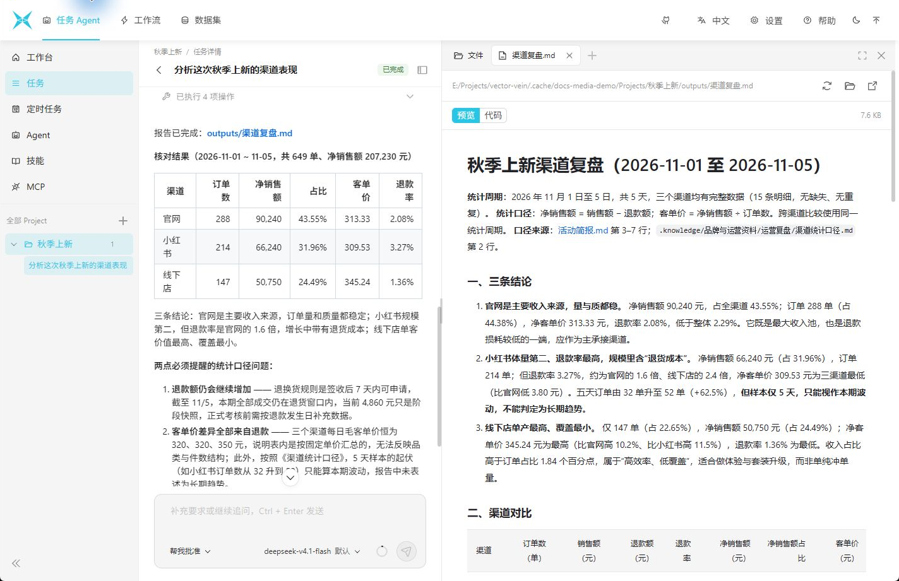

### 4. 配置 Skills、MCP 或设为定时任务

- **导入本地 Skills**：在左侧进入 **技能（Skills）**，点击导入并选择 **Local Agents**，即可扫描并勾选导入本机 `~/.agents/skills`、`~/.codex/skills` 或 `~/.claude/skills` 中的既有技能。
- **接入 MCP 工具**：在左侧进入 **MCP**，保存 MCP Server 配置后点击 **测试连接** 发现工具，启用所需工具后即可在 Agent 预设或工作台中选用。
- **设为定时任务**：如果这是一项周期性工作，进入左侧 **定时任务**，选择“每次新建任务”或“在同一任务中继续”，通过可视化执行时间表设置重复周期，并按需开启**运行完成后隐藏任务**与**运行完成后发送通知**。

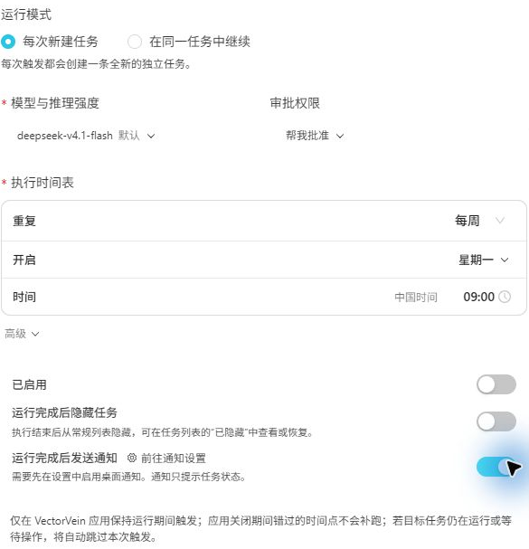

---

## 第二部分：从零创建可视化工作流（并挂载给 Agent）

当某项工作的步骤固定（例如“抓取指定网页 -> 按固定模板提炼 -> 同时输出 Markdown 与思维导图”或“读取文件 -> 模型处理 -> 导出文档”），使用**可视化工作流**可以将处理流程固定下来，方便反复运行。

### 1. 工作流设计的核心思想

#### 使用界面与编辑界面分离

每个工作流都包含两个视图：**工作流画布（编辑界面）** 用于节点连线，而 **界面设计（使用界面）** 则只把“每次运行会变化的参数”暴露为清爽的输入表单。

设计工作流时，建议遵循一条简单原则：**每次运行都会变的内容（如目标 URL、待处理文件）打开“眼睛”图标暴露到使用界面；固定不变的提示词模板、系统设定直接写在画布节点里，不要暴露到使用界面。**

下图中，右侧的使用界面显然比左侧更简洁易用：

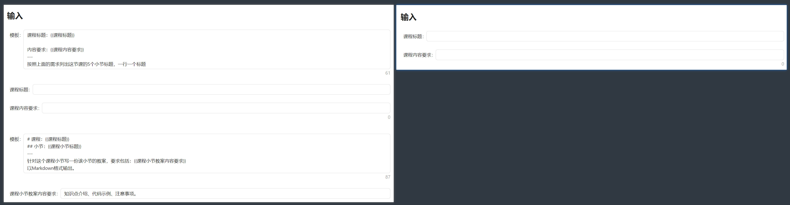

#### 小步快跑，边连边测

每添加两三个节点并连好线后，先保存并试跑一次，确认这一步的输出符合预期后再往下扩展。

---

### 2. 实战：搭建“网页抓取 + AI 多层级思维导图”工作流

下面我们动手搭建一条经典工作流，带你掌握触发器、文本合成、网页抓取、LLM 调用与多形态输出节点。

#### 步骤 1：放置触发器与文本输出

1. 进入顶部 **工作流** 空间，创建一个新的空工作流，在详情页点击 **【更多操作】 -> 【编辑】** 打开画布。
2. 从左侧节点库找到 **触发器 -> 按钮触发器**，拖拽到画布中。
3. 从左侧找到 **输出 -> 文本呈现** 节点，拖拽到画布中。在 `文本内容` 端口填入 `你好`，在 `文本标题` 端口填入 `输出标题`。

此时画布如下所示：
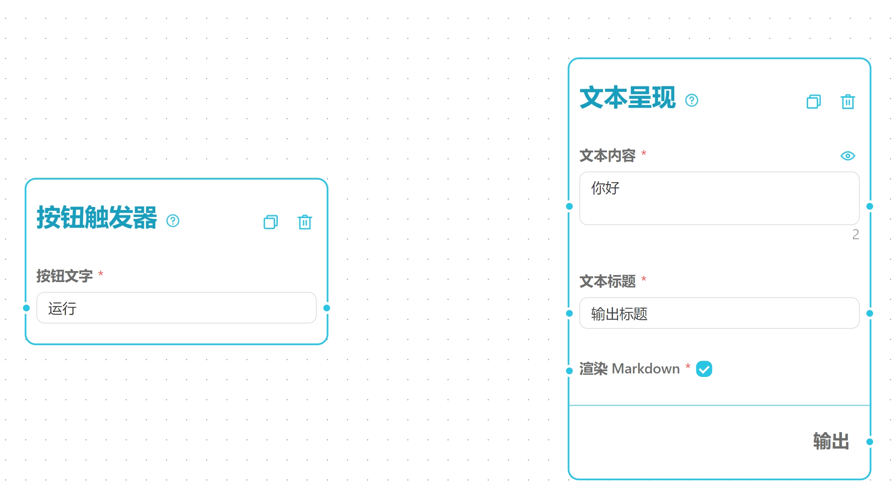

> **提示**：**按钮触发器** 只需要放在画布上即可，无需与其它节点连线。**文本呈现** 的“文本标题”用于在运行结果页区分多个不同输出。

点击顶部 **界面设计** 预览使用界面，可以看到触发按钮与静态文本输出：
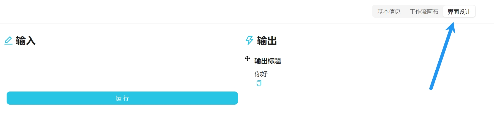

#### 步骤 2：使用“文本合成”节点管理变量模板

1. 切回 **工作流画布**，从左侧拖入 **文本处理 -> 文本合成** 节点：
   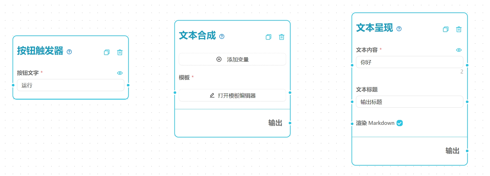
2. 在 **文本合成** 节点上点击添加变量：先添加单行变量 `标题`，再添加多行输入框变量 `正文`：
   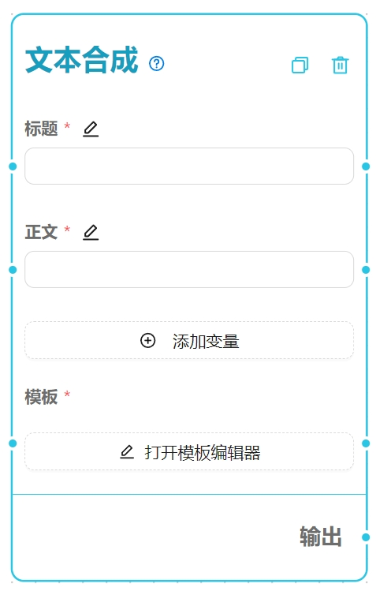
3. 在模板框中用 `{{变量名称}}` 编写合成格式（也可直接拖拽变量标签插入模板）：
   ```markdown
   《{{标题}}》
   ---
   {{正文}}
   ```
   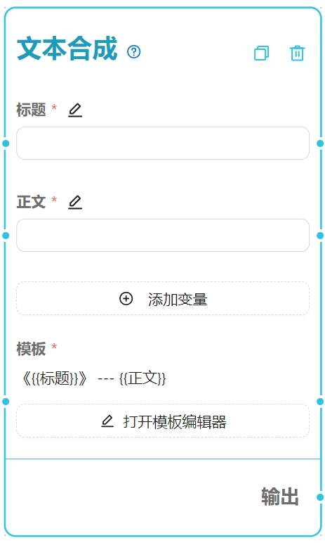
4. 从 **文本合成** 的输出端口拖出一根连线，连接到 **文本呈现** 的 `文本内容` 端口：
   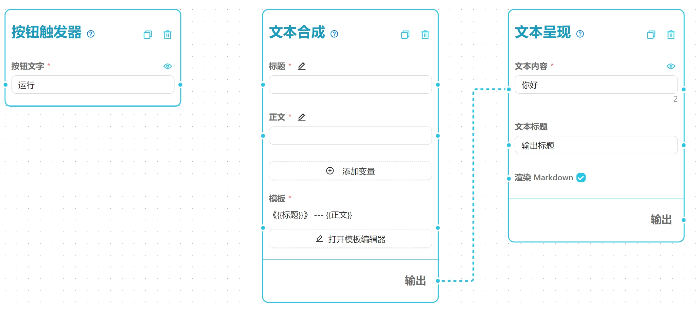
5. 点亮 `标题` 和 `正文` 右侧的 **眼睛** 图标（将其暴露到使用界面），点击 **保存** 回到使用界面，填入内容并点击运行，右侧即可看到按模板合成后的结果：
   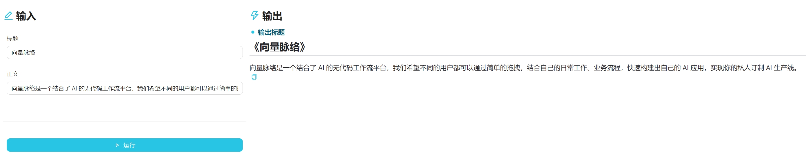

> **提示**：当 **文本呈现** 的 `文本内容` 端口接入了上游连线后，运行时会自动使用上游传来的数据，忽略节点原本填写的默认值 `你好`。

#### 步骤 3：接入网页抓取节点

1. 重新打开编辑画布，从左侧拖入 **网络爬虫 -> 文本爬虫** 节点。
2. 将 **文本爬虫** 的 `网页标题`、`网页正文` 输出端口，分别连接到 **文本合成** 的 `标题`、`正文` 输入端口，并关闭 **文本合成** 上这两个变量的 **眼睛** 图标（只保留文本爬虫的 `目标网址` 眼睛开启）：
   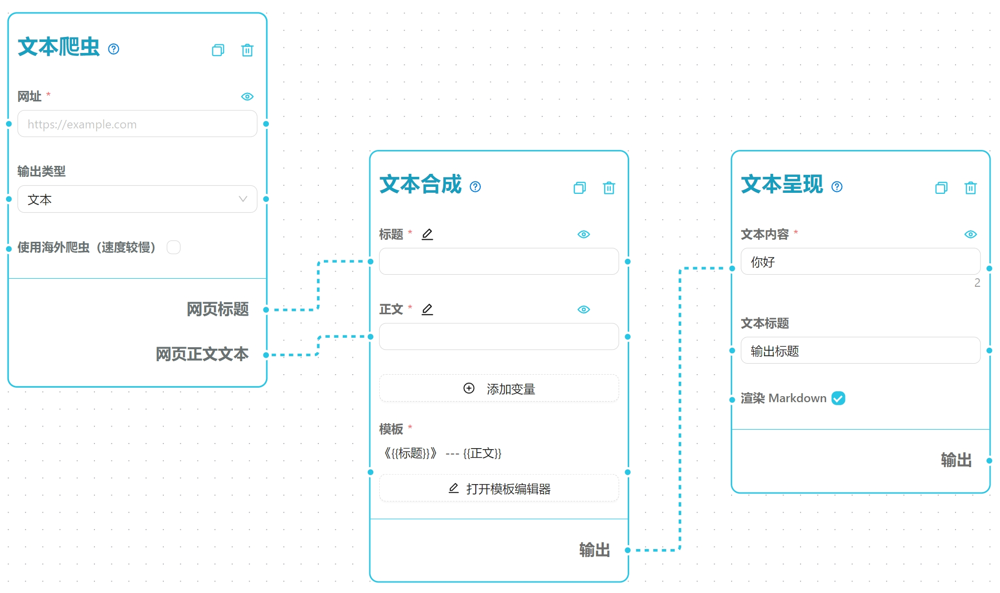
3. 点击 **保存** 回到使用界面，输入任意文章 URL（例如 [What is Azure OpenAI Service?](https://learn.microsoft.com/en-us/azure/ai-services/openai/overview)）并点击 **运行**，右侧即可展示抓取并排版好的网页标题与正文：
   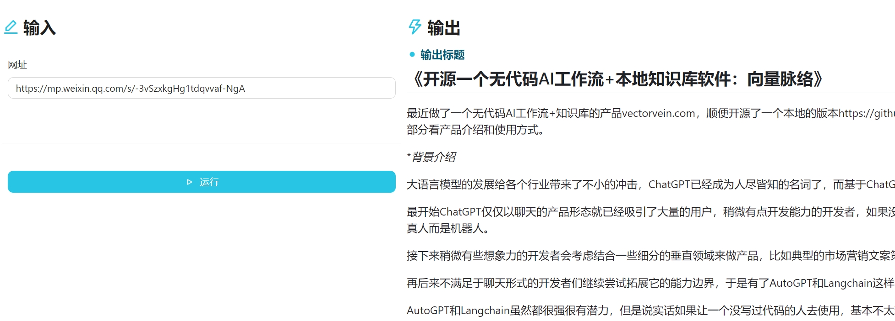

#### 步骤 4：串联大语言模型（LLM）与思维导图输出

1. 回到编辑画布，将 **文本合成** 的模板改为发给 AI 的提示词：
   ```markdown
   # {{标题}}
   {{正文}}

   ---

   总结：
   ```
2. 从左侧 **AI模型** 分类中拖入一个模型节点（如通用 LLM、DeepSeek 或 OpenAI 节点），放置在 **文本合成** 与 **文本呈现** 之间。
3. 调整连线：将鼠标移到原连线靠近 **文本呈现** 的端点处，待光标变为十字箭头后按住左键，将连线改接到模型节点的 `输入提示词` 端口，再把模型节点的输出连接到 **文本呈现**（选中连线按 `Backspace` 也可直接删除连线）：
   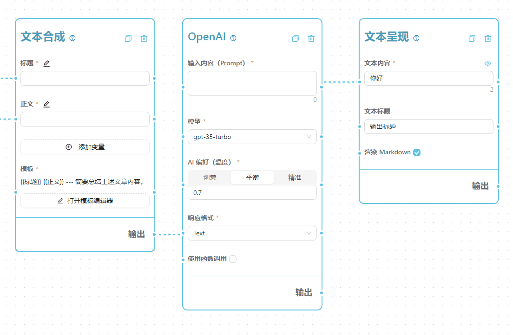
   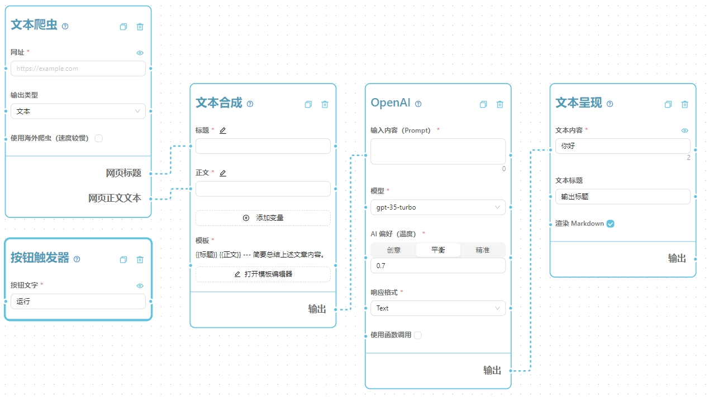
4. 保存并试跑一次，确认 AI 能正常输出文章摘要：
   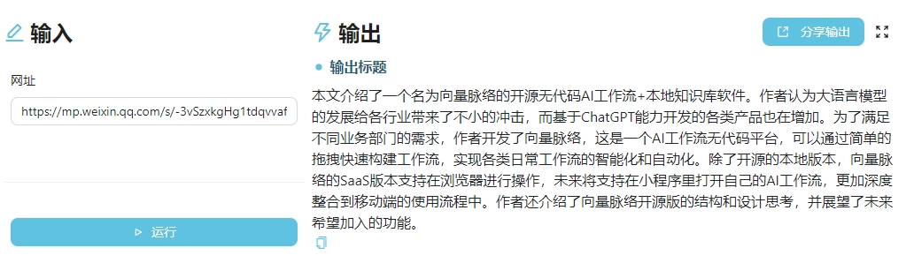
5. 再次回到画布，从左侧拖入 **输出 -> 思维导图** 节点，从模型节点的输出端口再拉一根线连接到 **思维导图** 的 `Markdown 内容` 端口（一个输出端口可以同时连接多个下游节点）：
   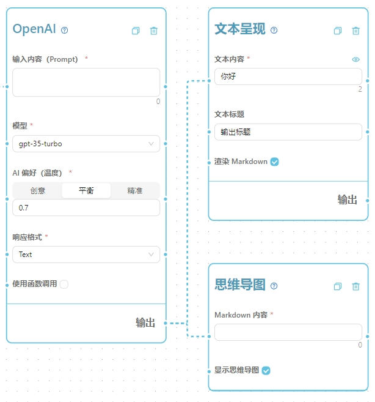
6. 将 **文本合成** 的模板调整为要求输出多层级 Markdown 思维导图：
   ```markdown
   {{标题}}
   {{正文}}

   ---

   请将以上文章总结为一个多层级的思维导图，以 Markdown 的格式用中文输出。
   ```
7. 保存并运行，你将同时获得 Markdown 大纲与可交互缩放的思维导图：
   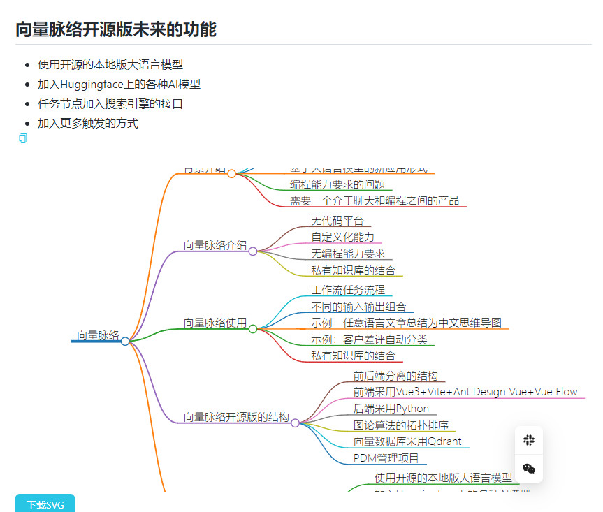
8. 最后别忘了在画布左上角修改工作流的名称、标签与详细描述，方便日后检索：
   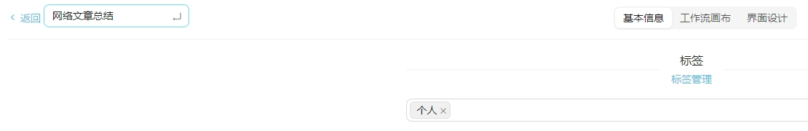

---

### 3. 进阶：把这条工作流挂载给 Agent 调用

工作流保存且状态为有效（Valid）后，你不仅可以在工作流界面、定时任务、本地 HTTP API（`http://127.0.0.1:8787`）或 `VectorVeinCLI` 中运行它，还可以直接将它挂载给 **任务 Agent**：

1. 进入 **任务 Agent -> Agent**，打开目标 Agent 的编辑页。
2. 在 **工具与能力 -> 可调用的工作流** 标签页勾选该工作流并保存。
3. 之后在任务中，当你让 Agent 处理一组网页链接或执行该流水线时，Agent 就能按输入参数调用这条工作流，并将执行记录关联在任务详情中。